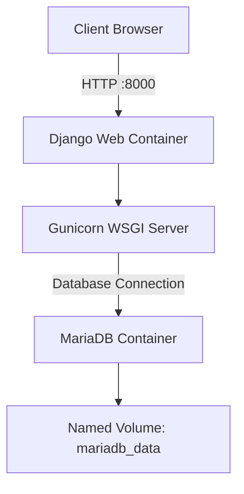
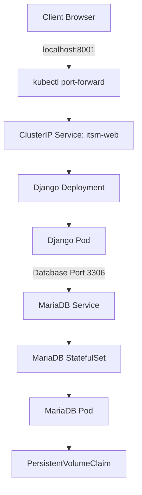
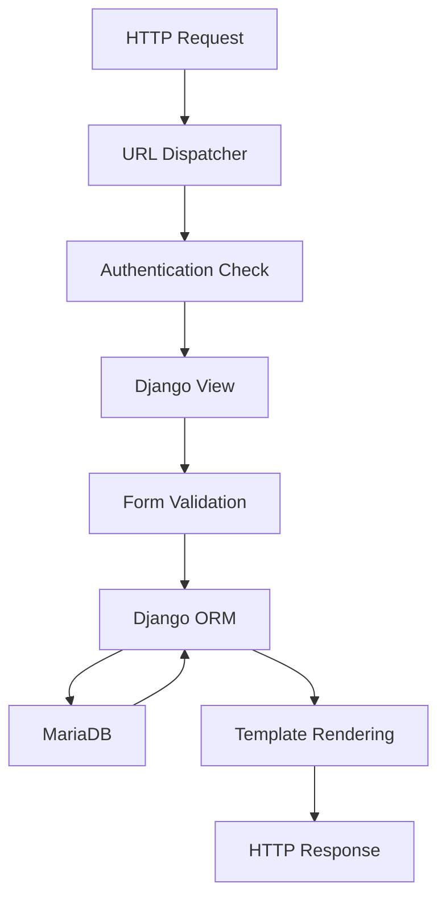
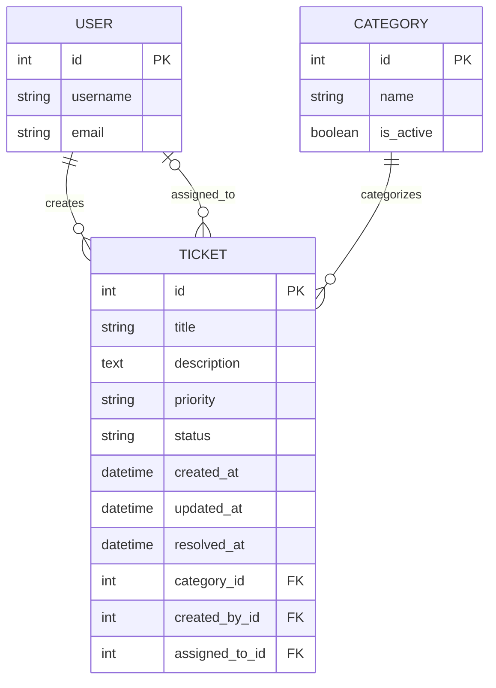

# ITSM Ticket Management System

**A containerized IT Service Management application built with Django, MariaDB, Bootstrap, Docker, Docker Compose, and Kubernetes.**


---

## 1. Project Overview

The **ITSM Ticket Management System** is a browser-based application designed to manage IT support tickets through a centralized interface.

The application follows Django's Model-View-Template (MVT) architecture and uses MariaDB as its relational database. Bootstrap provides the frontend interface, while Docker and Kubernetes provide containerization and deployment capabilities.

The project is developed for the **IT Security Management & DevOps** course. Its scope includes application development, database integration, container orchestration, deployment validation, performance testing, observability, and fault-tolerance evaluation.

### Project Objectives

| Objective | Implementation |
|---|---|
| Web application development | Django MVT architecture |
| Database integration | MariaDB and Django ORM |
| Authentication | Django Authentication Framework |
| Frontend development | HTML5, CSS3, Bootstrap |
| Containerization | Docker multi-stage build |
| Container orchestration | Docker Compose |
| Infrastructure orchestration | Kubernetes |
| Local cluster environment | Minikube |
| Persistent storage | Kubernetes PersistentVolumeClaim |
| Health monitoring | Django health endpoint and Kubernetes probes |
| Performance evaluation | Load testing |
| Fault tolerance | Kubernetes restart and recovery analysis |

## 2. Implementation Status

| Component | Status | Verification |
|---|---|---|
| Django application | Implemented | Verified |
| Authentication | Implemented | Verified |
| Ticket CRUD | Implemented | Local verification completed |
| Ticket search | Implemented | Verified |
| MariaDB integration | Implemented | Connection verified |
| Docker multi-stage image | Built | Build successful |
| Gunicorn runtime | Implemented | Container execution verified |
| Docker Compose | Implemented | Deployment successful |
| Kubernetes namespace | Implemented | Applied |
| Django Deployment | Implemented | 1/1 ready observed |
| MariaDB StatefulSet | Implemented | 1/1 ready observed |
| Kubernetes Services | Implemented | Applied |
| PersistentVolumeClaim | Implemented | Bound observed |
| Kubernetes health probes | Configured | HTTP 200 observed |
| Kubernetes CRUD validation | Pending | Evidence required |
| Node.js application comparison | Pending | Behavioural comparison required |
| Load testing | Pending | Script and results required |
| Fault-tolerance experiment | Pending | Controlled experiment required |
| Final report | In progress | Evidence and analysis required |

> **Note:** Implementation and verification are different. A successfully deployed application does not automatically demonstrate functional correctness, performance, or fault tolerance.

## 3. Functional Specifications

### Application Features

| Feature | Description | Technology |
|---|---|---|
| Authentication | User login and logout | Django Auth |
| Dashboard | Displays total and recent tickets | Django Views |
| Ticket creation | Creates new support tickets | Django ModelForm |
| Ticket listing | Displays stored tickets | Django ORM |
| Ticket search | Searches by title, description, and category | Django QuerySet |
| Ticket modification | Updates existing tickets | Django ModelForm |
| Ticket deletion | Deletes tickets after confirmation | HTTP POST |
| Categories | Classifies support tickets | MariaDB |
| Priority | LOW, MEDIUM, HIGH, CRITICAL | Django Model Choices |
| Status | OPEN, IN_PROGRESS, PENDING, RESOLVED, CLOSED | Django Model Choices |
| Administration | Database administration interface | Django Admin |
| Health endpoint | Returns application health information | JSON Response |

### Application Endpoints

| Endpoint | HTTP Method | Purpose |
|---|---|---|
| `/` | GET | Dashboard |
| `/login/` | GET, POST | User authentication |
| `/logout/` | POST | User logout |
| `/tickets/` | GET | List and search tickets |
| `/tickets/create/` | GET, POST | Create ticket |
| `/tickets/<id>/edit/` | GET, POST | Update ticket |
| `/tickets/<id>/delete/` | GET, POST | Confirm and delete ticket |
| `/admin/` | GET, POST | Django administration |
| `/health/` | GET | Application health response |

All ticket-management views require authentication through Django's `login_required` decorator.

## 4. Technology Stack

### Backend

| Technology | Version | Purpose |
|---|---|---|
| Python | 3.11.9 | Local development runtime |
| Python | 3.12.16 | Container runtime |
| Django | 5.2.19 | Web application framework |
| Gunicorn | 26.2.0 | WSGI application server |
| mysqlclient | 2.3.0 | Database connectivity |
| python-dotenv | Project dependency | Environment configuration |

### Database and Frontend

| Technology | Version | Purpose |
|---|---|---|
| MariaDB | 13.0.2 local | Local database |
| MariaDB | 11.4 container | Container database |
| Django ORM | Django 5.2 | Database abstraction |
| HTML5 | Standard | Page structure |
| CSS3 | Standard | Styling |
| Bootstrap | 5.3.3 | Responsive interface |
| JavaScript | Browser runtime | Client-side interaction |

### Infrastructure and DevOps

| Technology | Purpose |
|---|---|
| Docker | Container image construction |
| Docker Compose | Multi-container deployment |
| Kubernetes | Workload orchestration |
| Minikube | Local Kubernetes cluster |
| kubectl | Kubernetes administration |
| PersistentVolumeClaim | Persistent database storage |
| Kubernetes Secret | Database credential management |
| k6 / approved alternative | Load testing |

## 5. System Architecture

### 5.1 Docker Compose Architecture

The Docker Compose deployment consists of two independent services connected through a private Docker network.



**Request flow:**

1. The browser sends an HTTP request to the Django container.
2. Gunicorn receives the request and invokes the Django application.
3. Django processes the request through its views, forms, and models.
4. Django ORM communicates with MariaDB through the Docker network.
5. MariaDB reads or updates the required records.
6. Django returns the HTTP response to the client.

### 5.2 Kubernetes Architecture

The Kubernetes deployment separates application workloads, database workloads, networking, and persistent storage.



### 5.3 Network Configuration

| Component | Network / Port | Description |
|---|---|---|
| Django container | 8000 | Application port |
| MariaDB container | 3306 | Database port |
| Docker Compose web | Host 8000 | Browser access |
| Kubernetes web Service | 8000 | Cluster-internal access |
| Kubernetes port forwarding | Host 8001 | Local browser access |
| MariaDB Service | 3306 | Cluster-internal database access |

The Kubernetes web Service uses `ClusterIP`. This exposes the application within the cluster without directly publishing it externally. `kubectl port-forward` provides local access for demonstration and testing.

## 6. Application Architecture

The application follows Django's Model-View-Template (MVT) design pattern.

| Layer | Responsibility | Components |
|---|---|---|
| Presentation | User interface and form rendering | HTML, Bootstrap |
| Routing | Maps HTTP requests to views | Django URL configuration |
| Application logic | Request processing and validation | Django Views |
| Validation | Input validation and form processing | Django ModelForms |
| Data access | Database operations | Django ORM |
| Persistence | Relational data storage | MariaDB |

### Request Processing



## 7. Database Architecture

MariaDB provides persistent relational storage. Django ORM manages database queries, model validation, and migration operations.

### Main Entities

| Entity | Responsibility |
|---|---|
| User | Stores application user accounts |
| Category | Defines ticket classifications |
| Ticket | Stores ticket details and lifecycle information |
| Comment | Database model retained for possible future use |
| ActivityLog | Database model retained for possible future use |

The current user interface focuses on ticket CRUD and does not expose comment or activity-log functionality.

### Ticket Relationships



> The diagram represents the principal ticket relationships. The exact deployed schema is defined by the Django models and applied migrations.

## 8. Configuration and Environment Variables

### 8.1 Local Environment

The application loads database settings from a local `.env` file using `python-dotenv`.

Example configuration:

```dotenv
DB_NAME=itsm_db
DB_USER=your_database_user
DB_PASSWORD=your_database_password
DB_HOST=localhost
DB_PORT=3306
MARIADB_ROOT_PASSWORD=your_local_root_password
```

Replace the placeholder values with the credentials configured in your environment.

### 8.2 Environment-Specific Database Hosts

| Environment | `DB_HOST` | `DB_PORT` |
|---|---|---|
| Local Windows | `localhost` | `3306` |
| Docker Compose | `db` | `3306` |
| Kubernetes | `mariadb` | `3306` |

Containerized applications use service DNS names rather than `localhost` to communicate with other containers or Pods.

### 8.3 Kubernetes Secrets

The Kubernetes database Secret is named `itsm-db-secret` and belongs to namespace `itsm`.

Database credentials are injected into the application environment through Kubernetes configuration.

Never commit `.env` files, publish decoded Secret values, or include credentials in screenshots.

### 8.4 Production Configuration Requirements

Before treating the application as production-ready, configure:

- A secret Django `SECRET_KEY`.
- `DEBUG=False`.
- Appropriate `ALLOWED_HOSTS`.
- Secure cookie settings.
- HTTPS and appropriate proxy settings.
- Restricted database permissions.
- Secure handling and rotation of credentials.

The previously observed Django debug error page indicates that runtime hardening remains necessary.

## 9. Local Development Setup

### 9.1 Prerequisites

| Software | Requirement |
|---|---|
| Windows | Windows 10/11 |
| Python | 3.11.9 |
| MariaDB | Local database service |
| Git | Repository management |
| Visual Studio Code | Recommended editor |
| PowerShell | Command-line environment |

### 9.2 Clone the Repository

```powershell
git clone https://github.com/LordXapose/ITSM_Project_files.git

cd ITSM_Project_files
```

### 9.3 Create a Virtual Environment

```powershell
python -m venv .venv

.\.venv\Scripts\Activate.ps1
```

### 9.4 Install Dependencies

```powershell
python -m pip install --upgrade pip

pip install -r requirements.txt
```

### 9.5 Configure the Database

Create the MariaDB database and database user according to your local configuration.

Configure the `.env` file in the project root.

Verify the database configuration before running migrations.

### 9.6 Apply Migrations

```powershell
python manage.py migrate
```

### 9.7 Create an Administrator

```powershell
python manage.py createsuperuser
```

### 9.8 Start the Development Server

```powershell
python manage.py runserver
```

Open:

- Application: http://127.0.0.1:8000/
- Administration: http://127.0.0.1:8000/admin/
- Health endpoint: http://127.0.0.1:8000/health/

The Django development server is intended for local development. The containerized deployment uses Gunicorn.

## 10. Docker Image Build

### 10.1 Image Design

The application uses a multi-stage Docker build.

| Stage | Base image | Responsibility |
|---|---|---|
| Build | `python:3.12-bookworm` | Dependency installation and build preparation |
| Runtime | `python:3.12-slim-bookworm` | Application execution |

The runtime image uses Gunicorn and a non-root `app` user.

### 10.2 Build the Image

Run from the project root:

```powershell
docker build -t itsm-app:dev .
```

### 10.3 Verify the Image

```powershell
docker images itsm-app
```

Inspect image configuration:

```powershell
docker image inspect itsm-app:dev
```

The image has been built successfully and used by Docker Compose and Minikube.

## 11. Docker Compose Deployment

### 11.1 Start Services

```powershell
docker compose -f docker-compose.yaml up --build -d
```

### 11.2 Validate Compose Configuration

```powershell
docker compose -f docker-compose.yaml config --quiet
```

### 11.3 Check Container Status

```powershell
docker compose -f docker-compose.yaml ps
```

### 11.4 Inspect Logs

```powershell
docker compose -f docker-compose.yaml logs --tail=100
```

For application-specific logs:

```powershell
docker compose -f docker-compose.yaml logs web
```

For database-specific logs:

```powershell
docker compose -f docker-compose.yaml logs db
```

### 11.5 Apply Database Migrations

```powershell
docker compose -f docker-compose.yaml exec web python manage.py migrate
```

### 11.6 Create an Administrator

```powershell
docker compose -f docker-compose.yaml exec web python manage.py createsuperuser
```

### 11.7 Access the Application

http://localhost:8000/

### 11.8 Stop Services

```powershell
docker compose -f docker-compose.yaml down
```

This stops and removes the containers while retaining the named database volume.

**Warning:** Do not use `docker compose down -v` unless you intentionally want to remove the associated persistent volumes and database data.

## 12. Kubernetes Deployment

### 12.1 Cluster Configuration

The local Kubernetes environment uses Minikube with a dedicated profile.

| Configuration | Value |
|---|---|
| Profile | `itsm` |
| Namespace | `itsm` |
| Application image | `itsm-app:dev` |
| Application Deployment | `itsm-web` |
| Application Service | `itsm-web` |
| Database StatefulSet | `mariadb` |
| Database Service | `mariadb` |
| Database Secret | `itsm-db-secret` |
| Application Service type | ClusterIP |

### 12.2 Check Minikube

```powershell
minikube status -p itsm
```

Check the Kubernetes node:

```powershell
kubectl --context=itsm get nodes
```

### 12.3 Load the Application Image

```powershell
minikube image load -p itsm itsm-app:dev
```

This makes the locally built application image available to the Minikube cluster.

### 12.4 Create or Update the Database Secret

Run from the project root:

```powershell
kubectl --context=itsm create secret generic itsm-db-secret `
  --namespace=itsm `
  --from-env-file=.env `
  --dry-run=client -o yaml |
  kubectl --context=itsm apply -f -
```

This command creates or updates the Kubernetes Secret without printing its decoded values.

### 12.5 Apply Kubernetes Manifests

```powershell
kubectl --context=itsm apply -f .\k8s\
```

### 12.6 Apply Database Migrations

```powershell
kubectl --context=itsm -n itsm exec deployment/itsm-web -- python manage.py migrate
```

### 12.7 Create an Administrator

```powershell
kubectl --context=itsm -n itsm exec -it deployment/itsm-web -- python manage.py createsuperuser
```

Each deployment environment has its own database. Therefore, an administrator created in the local environment or Docker Compose environment is not automatically available in Kubernetes.

### 12.8 Inspect Kubernetes Resources

Pods:

```powershell
kubectl --context=itsm -n itsm get pods
```

Deployments:

```powershell
kubectl --context=itsm -n itsm get deployments
```

StatefulSets:

```powershell
kubectl --context=itsm -n itsm get statefulsets
```

Services:

```powershell
kubectl --context=itsm -n itsm get services
```

Persistent storage:

```powershell
kubectl --context=itsm -n itsm get pvc
```

### 12.9 Access the Application

The application Service uses `ClusterIP`, so it is accessible internally within the cluster.

For local browser access, use port forwarding.

Run the following command in a separate PowerShell window and leave it running:

```powershell
kubectl --context=itsm -n itsm port-forward service/itsm-web 8001:8000
```

Open:

http://localhost:8001/

Port 8001 is used because host port 8000 is already occupied by another application environment.

## 13. Application Health and Validation

### 13.1 Health Endpoint

The Django application exposes:

```text
GET /health/
```

Expected response:

```json
{
  "status": "healthy",
  "application": "ITSM Project"
}
```

### 13.2 Validate Kubernetes Health

```powershell
Invoke-WebRequest http://localhost:8001/health/ -UseBasicParsing
```

The observed Kubernetes response was HTTP 200 with a healthy JSON status.

### 13.3 Kubernetes Probes

The web Deployment configures Kubernetes readiness and liveness probes against `/health/`.

| Probe | Purpose |
|---|---|
| Readiness probe | Determines whether the container is ready to receive traffic |
| Liveness probe | Determines whether the container should be restarted |
| Health endpoint | Returns application health information |

**Limitation:** The current endpoint reports application-level health only. It does not independently verify database connectivity. Therefore, an HTTP 200 response should not be interpreted as proof that all application dependencies are operational.

### 13.4 Local Django Validation

Run:

```powershell
python manage.py check
```

Expected result:

```text
System check identified no issues (0 silenced).
```

Check migration consistency:

```powershell
python manage.py makemigrations --check --dry-run
```

Expected result:

```text
No changes detected
```

Apply pending migrations:

```powershell
python manage.py migrate
```

### 13.5 Required Functional Evidence

For final submission, collect evidence of:

- Successful application login.
- Ticket creation.
- Ticket listing and search.
- Ticket modification.
- Ticket deletion.
- Successful Django administration access.
- Successful Kubernetes application access.
- Successful Kubernetes health check.

Kubernetes CRUD verification must be recorded separately from local development verification.

## 14. Load Testing

**Status: Pending**

Load testing will evaluate application responsiveness and resource consumption under controlled concurrent workloads.

The selected testing tool should follow the course requirements. Candidate tools include k6, Locust, Apache JMeter, and `hey`.

### 14.1 Proposed Test Parameters

| Parameter | Description |
|---|---|
| Target | Docker Compose or Kubernetes deployment |
| Request type | HTTP GET and approved application workflows |
| Virtual users | Defined according to assignment requirements |
| Test duration | Defined according to assignment requirements |
| Ramp-up | Gradual increase in concurrent load |
| Performance metrics | Latency, throughput, and error rate |
| Infrastructure metrics | CPU and memory consumption |

### 14.2 Required Performance Metrics

| Metric | Description |
|---|---|
| p50 latency | Median request response time |
| p90 latency | 90th percentile response time |
| p95 latency | 95th percentile response time |
| p99 latency | 99th percentile response time |
| Throughput | Requests processed per second |
| Error rate | Percentage of failed requests |
| CPU utilization | Application and database CPU consumption |
| Memory utilization | Application and database memory consumption |

### 14.3 Results

The following table should be populated after execution.

| Metric | Test result |
|---|---|
| Total requests | Pending |
| Successful requests | Pending |
| Failed requests | Pending |
| p50 latency | Pending |
| p90 latency | Pending |
| p95 latency | Pending |
| p99 latency | Pending |
| Throughput | Pending |
| Peak CPU usage | Pending |
| Peak memory usage | Pending |

### 14.4 Repository Location

Proposed structure:

```text
loadtest/
└── k6-script.js
```

No performance target should be reported as achieved until supported by actual measurements.

## 15. Observability and Fault Tolerance

**Status: Pending**

This section evaluates how the application behaves when a container or Pod fails and whether Kubernetes restores the expected workload.

### 15.1 Monitoring Commands

Inspect Pod status:

```powershell
kubectl --context=itsm -n itsm get pods
```

Inspect events:

```powershell
kubectl --context=itsm -n itsm get events --sort-by=.lastTimestamp
```

Inspect application logs:

```powershell
kubectl --context=itsm -n itsm logs deployment/itsm-web --tail=100
```

Inspect resource utilization:

```powershell
kubectl --context=itsm -n itsm top pods
```

If resource metrics are unavailable, the Minikube metrics components may need to be enabled and allowed to initialize.

### 15.2 Fault-Tolerance Experiment

The controlled experiment should document the following sequence:

| Step | Observation | Required evidence |
|---|---|---|
| 1 | Initial Pod state | Pod status and restart count |
| 2 | Controlled application container failure | Failure event or command output |
| 3 | Kubernetes detects failure | Restart count increases |
| 4 | Container recovery | Pod becomes ready again |
| 5 | Application recovery | Health endpoint returns HTTP 200 |

A previous Pod restart was observed, but it has not yet been documented as a controlled failure-and-recovery experiment.

### 15.3 Resource Management and Scaling

No Horizontal Pod Autoscaler (HPA) is currently configured.

Any proposed scaling strategy should consider:

- CPU and memory requests.
- CPU and memory limits.
- Measured application resource consumption.
- Load-test results.
- Database connection capacity.
- Application replica count.

An HPA threshold should be justified using measured results rather than an arbitrary percentage.

### 15.4 Known Limitations

The Minikube deployment uses a local single-node cluster. Consequently, it does not demonstrate high availability across independent worker nodes or production-grade infrastructure resilience.

A successful container restart also does not prove database fault tolerance or data recovery. Those require separate tests.

## 16. Security Considerations

| Area | Current implementation or requirement |
|---|---|
| Authentication | Django authentication framework |
| Password management | Django authentication mechanisms |
| CSRF protection | Django form protection |
| Database credentials | Environment variables |
| Kubernetes credentials | Kubernetes Secret |
| Container privileges | Non-root runtime user |
| Debug mode | Must be disabled for production |
| Secret key | Must be securely configured |
| Allowed hosts | Must be explicitly configured |
| Database permissions | Should follow least privilege |
| Persistent data | Docker volume and Kubernetes PVC |

### Security Limitations

- Development settings previously exposed Django debug details.
- Production-grade secret management has not yet been established.
- The current health endpoint does not test database connectivity.
- Minikube is a local demonstration environment, not a production security boundary.
- Database credentials must never be committed to Git.
- Public screenshots must not expose credentials, Secret values, or administrator passwords.

## 17. Repository Structure

```text
ITSM_Project_files/
│
├── config/
│   ├── __init__.py
│   ├── asgi.py
│   ├── settings.py
│   ├── urls.py
│   └── wsgi.py
│
├── core/
│   ├── migrations/
│   ├── admin.py
│   ├── apps.py
│   ├── forms.py
│   ├── models.py
│   ├── tests.py
│   ├── urls.py
│   └── views.py
│
├── templates/
│   └── core/
│       ├── base.html
│       ├── dashboard.html
│       ├── login.html
│       ├── ticket_form.html
│       ├── ticket_list.html
│       ├── ticket_update.html
│       └── ticket_confirm_delete.html
│
├── static/
│   ├── css/
│   └── js/
│
├── k8s/
│   ├── deployment.yaml
│   ├── mariadb.yaml
│   ├── namespace.yaml
│   └── service.yaml
│
├── loadtest/
│   └── k6-script.js
│
├── .dockerignore
├── .gitignore
├── Dockerfile
├── docker-compose.yaml
├── manage.py
├── README.md
└── requirements.txt
```

The `loadtest/` directory is a planned location until the test script has actually been created.

Local environment files, virtual environments, database files, caches, and machine-specific files should be excluded from version control.

## 18. Troubleshooting

| Problem | Possible cause | Recommended check |
|---|---|---|
| Django database connection error | Incorrect credentials or database host | Inspect `.env` and database service |
| MariaDB connection refused | Database service not running | Check MariaDB service status |
| Django migration error | Database unavailable or inconsistent migrations | Run `migrate` and inspect errors |
| HTTP 404 | Incorrect URL configuration | Inspect Django URL patterns |
| HTTP 403 | CSRF or permission issue | Check request method and CSRF token |
| Docker build failure | Dependency or build configuration issue | Inspect Docker build logs |
| Compose web container exits | Application configuration or database issue | Inspect `docker compose logs web` |
| Kubernetes Pod pending | Scheduling or resource issue | Inspect Pod description and events |
| Kubernetes image pull error | Image unavailable to Minikube | Run `minikube image load` |
| Kubernetes database connection failure | Incorrect Service DNS or credentials | Check Secret references and MariaDB Service |
| Kubernetes PVC pending | Storage provisioning issue | Inspect PVC and storage class |
| `kubectl top` unavailable | Metrics API unavailable | Check Minikube metrics components |

## 19. Git and GitHub Workflow

### 19.1 Inspect Repository Changes

```powershell
git status

git diff --check

git diff
```

### 19.2 Stage Project Files

Stage relevant files explicitly:

```powershell
git add README.md Dockerfile .dockerignore docker-compose.yaml k8s config core templates static requirements.txt
```

Stage the load-test directory only after the script has been created:

```powershell
git add loadtest/
```

Verify staged changes:

```powershell
git status
```

Never stage `.env`, virtual environments, database files, or credentials.

### 19.3 Commit and Push

```powershell
git commit -m "Update ITSM deployment documentation"

git push origin main
```

Repository:

https://github.com/LordXapose/ITSM_Project_files

## 20. Assignment Completion Matrix

| Deliverable | Current state | Remaining work |
|---|---|---|
| 1. Containerization and setup | Docker image and Compose deployed | Verify original Node.js functionality and Django parity; harden runtime settings |
| 2. Kubernetes deployment | Minikube deployment operational | Record CRUD evidence and deployment validation |
| 3. Functional validation and load testing | Partially completed | Commit test script, execute load tests, analyse performance |
| 4. Observability and fault tolerance | Not completed | Conduct controlled failure-and-recovery experiment; analyse resource behaviour |
| 5. Report and GitHub structure | Documentation in progress | technically done |

### Final Submission Requirements

Before submission, ensure that the repository and report contain:

- [ ] Complete Django application source code.
- [ ] Database models and migrations.
- [ ] Dockerfile and Docker Compose configuration.
- [ ] Kubernetes manifests.
- [ ] Successful deployment evidence.
- [ ] Kubernetes CRUD verification.
- [ ] Comparison against the original Node.js application.
- [ ] Load-testing scripts and results.
- [ ] Performance metrics and resource observations.
- [ ] Controlled fault-tolerance experiment.
- [ ] Observability evidence.
- [ ] Security considerations and limitations.
- [ ] Final technical report and reflection.

---

## Project Information

| Field | Details |
|---|---|
| Project | ITSM Ticket Management System |
| Course | IT Security Management & DevOps |
| Backend | Django |
| Database | MariaDB |
| Frontend | Bootstrap |
| Containerization | Docker |
| Orchestration | Docker Compose and Kubernetes |
| Local cluster | Minikube |
| Repository | [LordXapose/ITSM_Project_files](https://github.com/LordXapose/ITSM_Project_files) |
