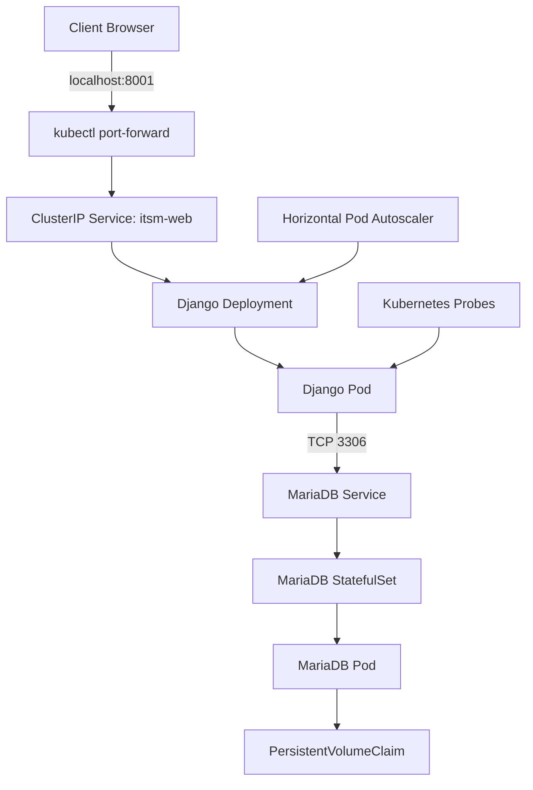
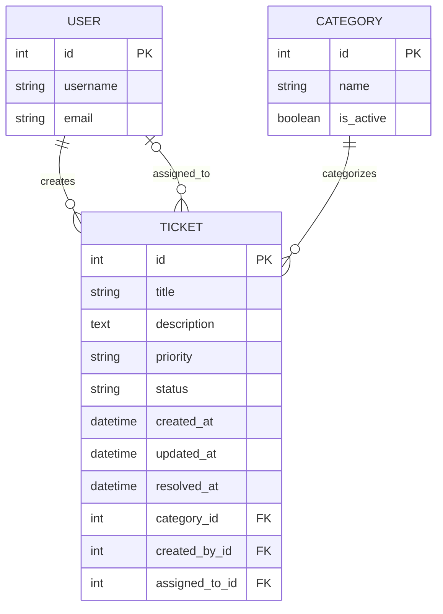
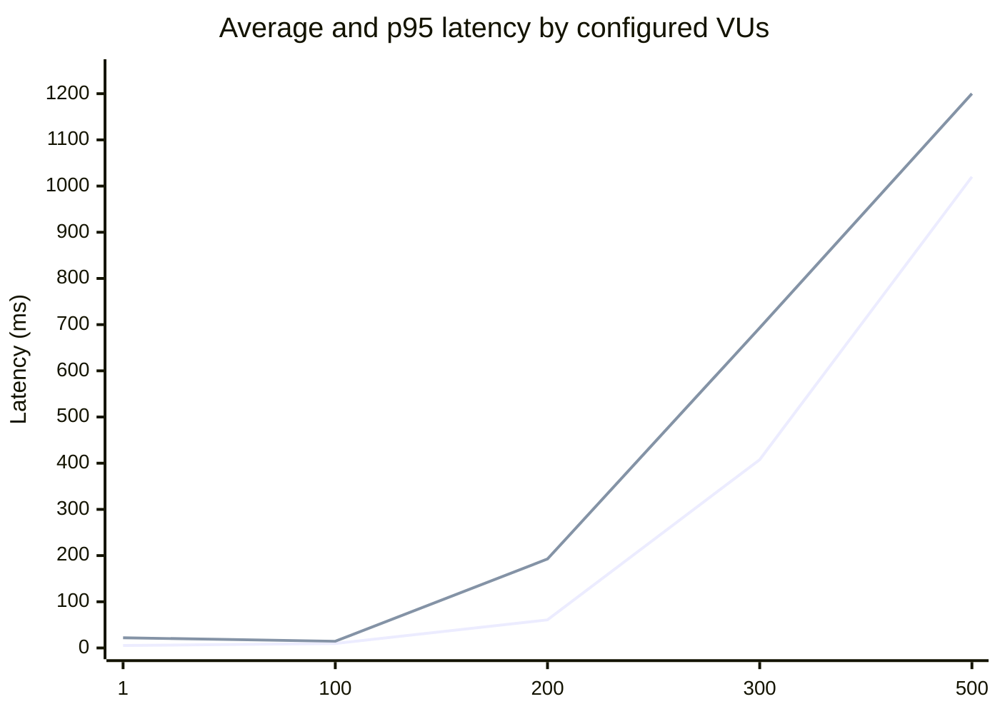
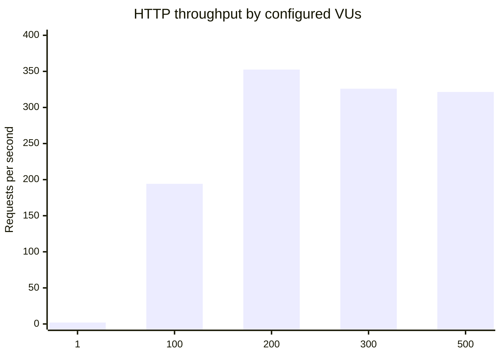

# ITSM Ticket Management System

**A containerized IT Service Management application built with Django, MariaDB, Bootstrap, Docker, Docker Compose, Kubernetes, Minikube and k6.**


---

# 1. Project Overview

## 1.1 Introduction

The **ITSM Ticket Management System** is a browser-based IT Service Management application designed to manage IT support requests through a centralized ticket-management interface.

The application was developed using Python and Django, with MariaDB as its relational database and Bootstrap as its frontend framework.

The application follows Django's Model-View-Template (MVT) architecture and supports authentication and the fundamental Create, Read, Update and Delete (CRUD) operations.

Beyond application development, the project demonstrates the deployment and management of a containerized application using Docker, Docker Compose and Kubernetes.

The complete implementation covers:

- Django application development.
- Relational database integration using MariaDB.
- User authentication and authorization.
- Ticket creation, listing, searching, updating and deletion.
- Docker image creation and containerization.
- Multi-container orchestration using Docker Compose.
- Kubernetes deployment using Minikube.
- Persistent database storage using PersistentVolumeClaims.
- Application health checks and Kubernetes probes.
- Horizontal Pod Autoscaling (HPA).
- Performance testing using k6.
- CPU and memory resource analysis.
- Troubleshooting and deployment validation.

## 1.2 Project Objectives

| Objective | Implementation |
|---|---|
| Web application | Django MVT architecture |
| Database integration | MariaDB and Django ORM |
| Authentication | Django Authentication Framework |
| Frontend | HTML5, CSS3 and Bootstrap |
| Containerization | Multi-stage Dockerfile |
| Multi-container deployment | Docker Compose |
| Container orchestration | Kubernetes |
| Local Kubernetes environment | Minikube |
| Persistent storage | Kubernetes PersistentVolumeClaim |
| Application health monitoring | Django health endpoint |
| Container health monitoring | Kubernetes readiness and liveness probes |
| Automatic scaling | Kubernetes Horizontal Pod Autoscaler |
| Performance evaluation | k6 HTTP load testing |
| Resource monitoring | kubectl top and container cgroup metrics |
| Version control | Git and GitHub |

## 1.3 Implementation and Verification Status

The distinction between implementation, execution and verification is important. A configured feature does not automatically mean that its complete functionality has been demonstrated.

| Component | Status | Details |
|---|---|---|
| Django application | Implemented | Application and authentication working |
| Ticket CRUD | Implemented | Local functionality verified |
| Ticket search | Implemented | Django QuerySet-based filtering |
| MariaDB integration | Implemented | Connection and migrations verified |
| Docker image | Implemented | Image successfully built |
| Docker Compose | Implemented | Web and database services deployed |
| Kubernetes namespace | Implemented | `itsm` namespace |
| Django Deployment | Implemented | `itsm-web` |
| MariaDB StatefulSet | Implemented | Database Pod deployed |
| Persistent database storage | Implemented | PVC binding observed |
| Health endpoint | Implemented | HTTP 200 observed |
| Kubernetes probes | Configured | Readiness and liveness probes |
| k6 load testing | Executed | 1, 100, 200, 300 and 500 VUs |
| CPU analysis | Executed | CPU quota and throttling investigated |
| Horizontal Pod Autoscaler | Configured | 70% CPU target, 1–5 replicas |
| HPA behavior | Observed | High and low CPU utilization reported |
| Kubernetes CRUD evidence | Requires final documentation | Record complete browser-based CRUD verification |
| Node.js comparison | Pending | Complete functional comparison against supplied application |
| Controlled fault-recovery test | Requires final verification | Earlier restart observations are not sufficient |
| Production security hardening | Pending | Complete production configuration and security review |
| Final project report | In progress | Consolidate screenshots, results and evidence |

---

# 2. Functional Specifications

## 2.1 Application Features

| Feature | Description | Technology |
|---|---|---|
| Authentication | User login and logout | Django Auth |
| Dashboard | Displays ticket information | Django Views |
| Ticket creation | Creates support tickets | Django ModelForm |
| Ticket listing | Displays stored tickets | Django ORM |
| Ticket search | Searches ticket information | Django QuerySet |
| Ticket modification | Updates existing tickets | Django ModelForm |
| Ticket deletion | Deletes tickets after confirmation | HTTP POST |
| Categories | Classifies support tickets | MariaDB |
| Priority | LOW, MEDIUM, HIGH, CRITICAL | Django model choices |
| Status | OPEN, IN_PROGRESS, PENDING, RESOLVED, CLOSED | Django model choices |
| Administration | Database administration interface | Django Admin |
| Health endpoint | Returns application health information | JSON |

## 2.2 Application Endpoints

| Endpoint | HTTP Method | Purpose |
|---|---|---|
| `/` | GET | Dashboard |
| `/login/` | GET, POST | User authentication |
| `/logout/` | POST | User logout |
| `/tickets/` | GET | Ticket listing and searching |
| `/tickets/create/` | GET, POST | Create a ticket |
| `/tickets/<id>/edit/` | GET, POST | Update a ticket |
| `/tickets/<id>/delete/` | GET, POST | Confirm and delete a ticket |
| `/admin/` | GET, POST | Django administration |
| `/health/` | GET | Application health response |

Ticket-management views use Django's `login_required` decorator.

The `/health/` endpoint is intentionally accessible without an authenticated browser session so that Kubernetes can perform health checks.

---

# 3. Technology Stack

| Layer | Technology | Version / Configuration |
|---|---|---|
| Local development | Python | 3.11.9 |
| Container runtime | Python | 3.12.x |
| Web framework | Django | 5.2.19 |
| WSGI server | Gunicorn | Container runtime |
| Database | MariaDB | 13.0.2 local; 11.4 container |
| Database driver | mysqlclient | 2.3.0 |
| Frontend | HTML5, CSS3 | Bootstrap 5.3.3 |
| Container engine | Docker | Local installation |
| Container orchestration | Docker Compose | Compose plugin |
| Cluster orchestration | Kubernetes | Minikube |
| Cluster management | kubectl | Context `itsm` |
| Load testing | k6 | 2.3.0 in temporary runner |
| Version control | Git | GitHub repository |
| Operating system | Windows | Windows 11 |

The local development environment and container environment use different Python versions. Similarly, the local MariaDB installation and containerized database use different versions.

These differences should be considered when reproducing the deployment.

---

# 4. System Architecture

## 4.1 Docker Compose Architecture

The Docker Compose deployment contains two primary services:

1. Django web application.
2. MariaDB database.

The services communicate through a private Docker network.


### Request flow

1. A client sends an HTTP request to the web application.
2. Gunicorn receives the request.
3. Gunicorn invokes the Django application.
4. Django processes the request through URL routing, views and forms.
5. Django ORM communicates with MariaDB.
6. MariaDB retrieves or updates the requested records.
7. Django returns an HTTP response to the browser.

## 4.2 Kubernetes Architecture

The Kubernetes deployment separates the web application and database workloads.



### Kubernetes components

| Component | Name | Responsibility |
|---|---|---|
| Namespace | `itsm` | Isolates application resources |
| Deployment | `itsm-web` | Manages Django Pods |
| Service | `itsm-web` | Exposes Django inside the cluster |
| StatefulSet | `mariadb` | Manages the database Pod |
| Service | `mariadb` | Provides database network access |
| Secret | `itsm-db-secret` | Stores database configuration |
| PersistentVolumeClaim | Database PVC | Requests persistent storage |
| HPA | `itsm-web-hpa` | Controls web replica scaling |

## 4.3 Network Configuration

| Component | Port | Purpose |
|---|---:|---|
| Django/Gunicorn | 8000 | Application listener |
| MariaDB | 3306 | Database listener |
| Docker Compose | 8000 | Host browser access |
| Kubernetes web Service | 8000 | Cluster-internal application access |
| Kubernetes port-forward | 8001 | Local browser and host testing |
| MariaDB Service | 3306 | Cluster-internal database access |

The Kubernetes web Service uses the `ClusterIP` type. Therefore, it is not directly accessible from outside the cluster.

Local access is provided through:

```powershell
kubectl --context=itsm -n itsm port-forward service/itsm-web 8001:8000
```

The port-forward process must remain running while the application is accessed through `http://localhost:8001/`.

The clean performance tests described later used the internal Kubernetes Service DNS address rather than the host port-forward connection.

---

# 5. Application and Database Architecture

## 5.1 Django MVT Architecture

Django uses the Model-View-Template architecture.

| Layer | Responsibility | Component |
|---|---|---|
| Presentation | Displays application pages | HTML and Bootstrap |
| Routing | Maps URLs to views | Django URL configuration |
| Application logic | Processes requests | Django Views |
| Validation | Validates user input | Django ModelForms |
| Data access | Performs database operations | Django ORM |
| Persistence | Stores relational records | MariaDB |

### How a ticket is created

1. The user opens `/tickets/create/`.
2. Django renders the ticket creation form.
3. The user submits the form.
4. Django validates the submitted information.
5. The view processes the valid ModelForm.
6. Django ORM inserts the record into MariaDB.
7. The application redirects the user to the appropriate page.

## 5.2 Database Entities

| Entity | Responsibility |
|---|---|
| User | Application accounts |
| Category | Ticket classification |
| Ticket | Ticket details and lifecycle information |
| Comment | Model retained for possible future use |
| ActivityLog | Model retained for possible future use |

The current interface focuses on ticket CRUD. Comment and ActivityLog functionality is not exposed through the current interface.



The Django model definitions and applied database migrations are the authoritative source of the actual database schema.

---

# 6. Configuration and Security

## 6.1 Environment Variables

The local application reads database configuration from `.env` using `python-dotenv`.

Example:

```dotenv
DB_NAME=itsm_db
DB_USER=your_database_user
DB_PASSWORD=your_database_password
DB_HOST=localhost
DB_PORT=3306
MARIADB_ROOT_PASSWORD=your_local_root_password
```

These are example values, not actual project credentials.

Never commit a real `.env` file to GitHub.

## 6.2 Database Hostnames

| Environment | DB_HOST | DB_PORT |
|---|---|---|
| Local Windows | `localhost` | 3306 |
| Docker Compose | `db` | 3306 |
| Kubernetes | `mariadb` | 3306 |

Inside a container, `localhost` refers to that container itself.

For example, the Django web container must use `db` to communicate with the Compose database service, not `localhost`.

Similarly, the Kubernetes web Pod must use the `mariadb` Service name.

## 6.3 Kubernetes Secrets

The Kubernetes database Secret is:

```text
itsm-db-secret
```

It is located in the `itsm` namespace.

Database configuration is injected into the application through Kubernetes environment configuration.

Do not print decoded Secret values or include real passwords in screenshots, reports or Git commits.

## 6.4 Security Considerations

Before production deployment, the following settings must be configured and verified:

- A unique Django `SECRET_KEY`.
- `DEBUG=False`.
- Explicit and restricted `ALLOWED_HOSTS`.
- Secure session and CSRF cookie settings.
- HTTPS.
- Appropriate reverse-proxy configuration.
- Least-privilege database credentials.
- Secure secret storage and rotation.
- Dependency vulnerability scanning.
- Container image security review.
- Appropriate access controls.

During development, a debug configuration and placeholder secret key were used.

A Django debug error page was encountered during development. Such pages must never be exposed publicly because they can disclose internal application information.

The current health endpoint verifies application responsiveness but does not independently verify MariaDB availability.

---

# 7. Local Development Setup

## 7.1 Prerequisites

- Windows 10/11.
- Python 3.11.9.
- MariaDB.
- Git.
- PowerShell.
- Visual Studio Code (recommended).

## 7.2 Clone the Repository

```powershell
git clone https://github.com/LordXapose/ITSM_Project_files.git

cd ITSM_Project_files
```

## 7.3 Create a Virtual Environment

```powershell
python -m venv .venv

.\.venv\Scripts\Activate.ps1
```

If PowerShell blocks activation, use an execution policy permitted by the machine or directly invoke the virtual environment's Python executable.

## 7.4 Install Dependencies

```powershell
python -m pip install --upgrade pip

pip install -r requirements.txt
```

## 7.5 Configure MariaDB

Create:

```text
Database: itsm_db
Database user: itsm_user
```

Configure the database credentials through `.env`.

The MariaDB Windows service must be running before Django can establish a local database connection.

## 7.6 Validate and Migrate

```powershell
python manage.py check

python manage.py makemigrations --check --dry-run

python manage.py migrate

python manage.py createsuperuser
```

The project successfully passed Django's system checks and the initial `core` migration was applied.

## 7.7 Start Django

```powershell
python manage.py runserver
```

Local application URLs:

- Application: http://127.0.0.1:8000/
- Administration: http://127.0.0.1:8000/admin/
- Health: http://127.0.0.1:8000/health/

The Django development server is intended for development. Gunicorn is used in the containerized deployment.

---

# 8. Docker Image Creation

## 8.1 Multi-Stage Docker Build

The Dockerfile uses two stages.

| Stage | Base image | Purpose |
|---|---|---|
| Build | `python:3.12-bookworm` | Dependency installation and build preparation |
| Runtime | `python:3.12-slim-bookworm` | Application execution |

The runtime image executes the Django application through Gunicorn.

The container uses a non-root `app` user.

## 8.2 Build the Image

Run from the project root:

```powershell
docker build -t itsm-app:dev .
```

Inspect the image:

```powershell
docker images itsm-app

docker image inspect itsm-app:dev
```

The image was successfully built and subsequently used by Docker Compose and Minikube.

---

# 9. Docker Compose Deployment

## 9.1 Validate Configuration

```powershell
docker compose -f docker-compose.yaml config --quiet
```

## 9.2 Start Services

```powershell
docker compose -f docker-compose.yaml up --build -d
```

## 9.3 Verify Containers

```powershell
docker compose -f docker-compose.yaml ps
```

## 9.4 Inspect Logs

```powershell
docker compose -f docker-compose.yaml logs --tail=100

docker compose -f docker-compose.yaml logs web

docker compose -f docker-compose.yaml logs db
```

## 9.5 Apply Database Migrations

```powershell
docker compose -f docker-compose.yaml exec web python manage.py migrate
```

Create an administrator if necessary:

```powershell
docker compose -f docker-compose.yaml exec web python manage.py createsuperuser
```

## 9.6 Access the Application

Open:

```text
http://localhost:8000/
```

## 9.7 Stop the Services

```powershell
docker compose -f docker-compose.yaml down
```

The named MariaDB volume is retained.

**Important:** Do not use `docker compose down -v` unless you deliberately want to remove the associated volumes and database data.

Docker Compose and Kubernetes use separate database instances. Changes to one environment do not automatically appear in the other.

---

# 10. Kubernetes Deployment Using Minikube

## 10.1 Cluster Configuration

| Configuration | Value |
|---|---|
| Minikube profile | `itsm` |
| kubectl context | `itsm` |
| Namespace | `itsm` |
| Application image | `itsm-app:dev` |
| Application Deployment | `itsm-web` |
| Application Service | `itsm-web` |
| Database StatefulSet | `mariadb` |
| Database Service | `mariadb` |
| Database Secret | `itsm-db-secret` |
| Application Service type | ClusterIP |

## 10.2 Check Cluster Status

```powershell
minikube status -p itsm

kubectl --context=itsm get nodes
```

The project used a single-node Minikube cluster.

## 10.3 Build the Image Inside Minikube

The following command was used during the Django `ALLOWED_HOSTS` troubleshooting process:

```powershell
minikube -p itsm image build -t itsm-app:dev .
```

Alternatively, load an image already built in the host Docker environment:

```powershell
minikube image load -p itsm itsm-app:dev
```

These are alternative methods.

An image built by the host Docker daemon is not automatically guaranteed to exist in Minikube's image store.

## 10.4 Create or Update Kubernetes Secrets

From the project root:

```powershell
kubectl --context=itsm create secret generic itsm-db-secret `
  --namespace=itsm `
  --from-env-file=.env `
  --dry-run=client -o yaml |
  kubectl --context=itsm apply -f -
```

Ensure `.env` contains only the variables required by the application and Kubernetes configuration.

## 10.5 Apply Kubernetes Manifests

```powershell
kubectl --context=itsm apply -f .\k8s\
```

Check Deployment rollout:

```powershell
kubectl --context=itsm -n itsm rollout status deployment/itsm-web
```

Apply database migrations:

```powershell
kubectl --context=itsm -n itsm exec deployment/itsm-web -- python manage.py migrate
```

Create a Kubernetes database administrator if one does not already exist:

```powershell
kubectl --context=itsm -n itsm exec -it deployment/itsm-web -- python manage.py createsuperuser
```

Local, Docker Compose and Kubernetes deployments use separate database instances or volumes. An administrator created in one environment is not automatically present in another.

## 10.6 Inspect Kubernetes Resources

```powershell
kubectl --context=itsm -n itsm get pods

kubectl --context=itsm -n itsm get deployments

kubectl --context=itsm -n itsm get statefulsets

kubectl --context=itsm -n itsm get services

kubectl --context=itsm -n itsm get pvc

kubectl --context=itsm -n itsm get events --sort-by=.lastTimestamp
```

## 10.7 Access the Kubernetes Application

Run in a separate PowerShell window:

```powershell
kubectl --context=itsm -n itsm port-forward service/itsm-web 8001:8000
```

Open:

```text
http://localhost:8001/
```

Host port 8001 was selected because port 8000 was already occupied by another application environment.

The port-forward process must remain active.

---

# 11. Application Health and Deployment Validation

## 11.1 Health Endpoint

The application provides:

```http
GET /health/
```

Expected response:

```json
{
  "status": "healthy",
  "application": "ITSM Project"
}
```

Validate the Kubernetes deployment:

```powershell
Invoke-WebRequest http://localhost:8001/health/ -UseBasicParsing
```

The endpoint returned HTTP 200 during Kubernetes validation.

## 11.2 Kubernetes Readiness and Liveness Probes

| Probe | Purpose |
|---|---|
| Readiness | Determines whether the container should receive Service traffic |
| Liveness | Determines whether Kubernetes should restart an unhealthy container |
| `/health/` | Provides the HTTP health response |

The web Deployment uses readiness and liveness probes against `/health/`.

**Limitation:** The health endpoint does not independently test the MariaDB connection.

An HTTP 200 response therefore proves that the endpoint responded successfully, not that every application dependency is available.

## 11.3 Django Validation

```powershell
python manage.py check

python manage.py makemigrations --check --dry-run

python manage.py migrate
```

Previously observed successful output:

```text
System check identified no issues (0 silenced).
No changes detected
```

## 11.4 Functional Validation Checklist

The following operations should be captured against the Kubernetes deployment:

- [ ] Successful login.
- [ ] Dashboard access.
- [ ] Ticket creation.
- [ ] Ticket listing.
- [ ] Ticket searching.
- [ ] Ticket modification.
- [ ] Ticket deletion.
- [ ] Django administration.
- [ ] Health endpoint returning HTTP 200.

Local CRUD verification should not be presented as Kubernetes CRUD verification.

---

# 12. Performance Testing Using k6

## 12.1 Test Environment

The main performance tests were executed from inside the Kubernetes cluster using k6.

Target:

```text
http://itsm-web.itsm.svc.cluster.local:8000
```

A temporary Kubernetes test runner used:

```text
Image: grafana/k6
Version: 2.3.0
Runner: k6-runner
Namespace: itsm
```

The runner is temporary testing infrastructure and is not part of the application Deployment.

## 12.2 Test Script

The main script is:

```text
loadtest/public.js
```

Each iteration performs two GET requests:

1. `GET /login/`
2. `GET /health/`

The script verifies successful HTTP responses and response checks, with a one-second sleep between iterations.

The default configuration includes:

| Parameter | Configuration |
|---|---|
| Default virtual users | 25 |
| Main test duration | 60 seconds |
| Smoke-test duration | 5 seconds |
| Failed HTTP request threshold | Less than 1% |
| p95 latency threshold | Below 1,000 ms |
| Check success threshold | Above 99% |

The CLI `--vus` argument overrides the default number of virtual users.

**Testing scope:** These tests measure public, read-only HTTP endpoints. They do not authenticate users, create tickets, update records, delete tickets or benchmark write-heavy database workloads.

## 12.3 Test Execution

An example command for an existing in-cluster runner:

```powershell
kubectl --context=itsm -n itsm exec k6-runner -- env BASE_URL=http://itsm-web.itsm.svc.cluster.local:8000 k6 run --vus 100 --duration 60s /tmp/public.js
```

Repeat with the required VU counts:

```text
1 VU
100 VUs
200 VUs
300 VUs
500 VUs
```

The 1-VU smoke test used a 5-second duration. The main test series used 60 seconds.

## 12.4 Performance Results

The following table consolidates the recorded clean in-cluster runs.

| Configured VUs | Duration | Iterations | HTTP requests | Throughput (req/s) | Average | Median | p90 | p95 | Maximum |
|---:|---:|---:|---:|---:|---:|---:|---:|---:|---:|
| 1 | 5s | 5 | 10 | 1.98 | 5.3ms | 1.67ms | — | 22.01ms | — |
| 100 | 60s | 5,922 | 11,844 | 194.22 | 9.75ms | 2.61ms | 6.65ms | 14.48ms | 388.84ms |
| 200 | 60s | 10,765 | 21,530 | 352.52 | 60.76ms | 24.91ms | 134.67ms | 192.54ms | 959.97ms |
| 300 | 60s | 10,022 | 20,044 | 325.97 | 407.74ms | 308.69ms | 667.27ms | 693.02ms | 1.36s |
| 500 | 60s | 10,014 | 20,028 | 321.49 | 1.02s | 1.00s | 1.12s | 1.20s | 2.29s |

| Configured VUs | Failed HTTP requests | Successful checks |
|---:|---:|---:|
| 1 | 0% | 100% (15/15) |
| 100 | 0% | 100% (17,766/17,766) |
| 200 | 0% | 100% (32,295/32,295) |
| 300 | 0% | 100% (30,066/30,066) |
| 500 | 0% | 100% (30,042/30,042) |

## 12.5 Interpretation

### 1–100 VUs

At 100 VUs, the application achieved approximately 194 requests per second with p95 latency of 14.48 milliseconds.

This indicates relatively low latency for the tested read-only workload.

### 200 VUs

The 200-VU test achieved the highest measured throughput:

- Throughput: 352.52 requests/second.
- Average latency: 60.76 milliseconds.
- p95 latency: 192.54 milliseconds.
- Failed HTTP requests: 0%.

This was the best-performing point in the recorded test series.

### 300 VUs

At 300 VUs:

- Throughput decreased to 325.97 requests/second.
- Average latency increased to 407.74 milliseconds.
- p95 latency increased to 693.02 milliseconds.

The system continued responding successfully, but performance had deteriorated considerably.

### 500 VUs

At 500 VUs:

- Throughput: 321.49 requests/second.
- Average latency: 1.02 seconds.
- p95 latency: 1.20 seconds.
- Failed HTTP requests: 0%.

The configured p95 threshold of 1,000 milliseconds was exceeded.

The k6 threshold failure represents a performance objective violation. It does not mean that Kubernetes crashed or that the application returned failed HTTP responses.

## 12.6 Performance Charts

### Latency



First line: Average latency.

Second line: p95 latency.

### Throughput



## 12.7 Capacity Interpretation

| Load | Observed behaviour | Interpretation |
|---|---|---|
| 100 VUs | Low latency | Comfortable for this workload |
| 200 VUs | Highest throughput | Best observed performance |
| 300 VUs | Latency increases sharply | Degradation begins |
| 500 VUs | p95 exceeds 1 second | Performance threshold breached |

The 200-VU result is the best-performing point in this test series, not a proven production-safe capacity limit.

Virtual users are not equivalent to simultaneous database connections or a guaranteed number of real human users.

---

# 13. Kubernetes Resource Monitoring and Bottleneck Analysis

## 13.1 Web Resource Configuration

The observed web Deployment resource configuration was:

| Resource | Request | Limit |
|---|---:|---:|
| CPU | 250m | 1000m |
| Memory | 256Mi | 1Gi |

The CPU limit of 1000m represents approximately one CPU core.

The CPU request of 250m represents the amount of CPU resource requested for scheduling and resource-utilization calculations.

## 13.2 Pod Resource Observations

Post-test `kubectl top pods` snapshots showed:

| Component | CPU observation | Memory observation |
|---|---:|---:|
| Django web Pod | Approximately 600–720m | 88–90Mi |
| MariaDB Pod | Approximately 6–9m | Approximately 120Mi |

These are point-in-time observations after testing, not guaranteed peak values.

The relatively low MariaDB CPU observed in these snapshots suggests that the web workload was more CPU-constrained during these measurements.

It does not prove that MariaDB cannot become a bottleneck under a different workload.

## 13.3 CPU Quota Investigation

The web container's cgroup reported:

```text
cpu.max = 100000 100000
```

This represents a quota of 100,000 microseconds of CPU time per 100,000-microsecond period.

In practical terms, the container was limited to approximately one CPU core.

A before-and-after comparison around the 300-VU test recorded:

| Counter | Before | After | Difference |
|---|---:|---:|---:|
| usage_usec | 88,510,786 | 148,938,053 | +60,427,267 |
| nr_periods | 1,362 | 2,018 | +656 |
| nr_throttled | 580 | 1,181 | +601 |
| throttled_usec | 50,175,340 | 129,504,721 | +79,329,381 |

Approximately 91.6% of CPU quota periods were throttled during this measured interval:

```text
601 / 656 × 100 = 91.6%
```

CPU usage increased by approximately 60.4 CPU-seconds over an interval of about 60 wall-clock seconds.

This is consistent with the application consuming approximately one CPU core of available capacity.

A later cumulative snapshot reported:

```text
Throttled periods: 1,789
Total periods:     2,785
```

This corresponds to approximately 64.2%.

However, this is a cumulative counter ratio and must not be represented as a clean 500-VU-only measurement.

A comparison against the earlier 300-VU snapshot showed 608 additional throttled periods out of 767 additional periods, approximately 79.3%. The measurement interval may include time outside the exact 500-VU test.

## 13.4 Bottleneck Analysis

The evidence indicates that the web container's CPU quota was a major performance constraint.

The supporting observations are:

1. Throughput reached its highest measured point at 200 VUs.
2. Throughput declined at 300 and 500 VUs.
3. Average and p95 latency increased significantly.
4. The web container had a hard CPU limit of one core.
5. Cgroup counters demonstrated frequent CPU throttling.
6. Post-test memory observations were substantially below the 1Gi limit.
7. MariaDB CPU observations were comparatively low.

**Conclusion:** Web-tier CPU capacity is the leading bottleneck indicated by the test results.

This is an evidence-based interpretation, not a complete code-profiling diagnosis.

Application profiling and realistic authenticated workloads would be needed to identify the precise Django or Gunicorn execution path responsible.

---

# 14. Horizontal Pod Autoscaling (HPA)

## 14.1 Purpose

Horizontal Pod Autoscaling automatically adjusts the number of Pod replicas based on observed resource utilization.

Instead of relying exclusively on a fixed number of application replicas, Kubernetes can increase or decrease the number of Pods according to workload demand.

## 14.2 HPA Configuration

The application HPA is named:

```text
itsm-web-hpa
```

The configured values are:

| Parameter | Value |
|---|---:|
| Target Deployment | `itsm-web` |
| Minimum replicas | 1 |
| Maximum replicas | 5 |
| Target CPU utilization | 70% |
| CPU request | 250m |
| CPU limit | 1000m |

The CPU utilization target is calculated relative to the CPU request, not the CPU limit.

For a 250m CPU request, 70% corresponds to approximately 175m average CPU utilization per Pod.

## 14.3 Verify HPA

```powershell
kubectl --context=itsm -n itsm get hpa
```

Inspect detailed configuration:

```powershell
kubectl --context=itsm -n itsm describe hpa itsm-web-hpa
```

Observe Deployment replicas:

```powershell
kubectl --context=itsm -n itsm get deployment itsm-web
```

Watch HPA continuously:

```powershell
kubectl --context=itsm -n itsm get hpa -w
```

## 14.4 Recorded HPA Observations

During the high-load investigation, the following output was observed:

```text
NAME           REFERENCE             TARGETS
itsm-web-hpa   Deployment/itsm-web   cpu: 382%/70%
```

A later observation showed:

```text
NAME           REFERENCE             TARGETS   MINPODS   MAXPODS   REPLICAS
itsm-web-hpa   Deployment/itsm-web   0%/70%   1         5         1
```

These observations demonstrate that the HPA was configured and that its reported CPU utilization changed between high-load and later low-load observations.

The later output showed the application at its minimum of one replica.

A target utilization above 100% of the CPU request is possible even though the container has a CPU limit. It means the observed CPU usage exceeded the requested amount.

**Important:** A high HPA target reading alone does not prove that additional replicas successfully became Ready. To claim successful scale-out and scale-in, record the actual replica changes and Pod readiness during the experiment.

## 14.5 HPA Limitations

- HPA depends on available resource metrics.
- CPU utilization is calculated relative to resource requests.
- Scaling is not instantaneous.
- New Pods require scheduling and startup time.
- Scaling the web tier does not automatically scale MariaDB.
- Additional replicas can increase database connections.
- A single-node Minikube environment does not demonstrate multi-node high availability.

The configured HPA provides an automatic scaling mechanism for the web Deployment, but production capacity and resilience have not been established by configuration alone.

---

# 15. Observability and Fault Tolerance

## 15.1 Monitoring Commands

```powershell
kubectl --context=itsm -n itsm get pods

kubectl --context=itsm -n itsm get events --sort-by=.lastTimestamp

kubectl --context=itsm -n itsm logs deployment/itsm-web --tail=100

kubectl --context=itsm -n itsm top pods
```

To observe Pod resource usage repeatedly:

```powershell
while ($true) {
    Get-Date -Format "HH:mm:ss"
    kubectl --context=itsm -n itsm top pods
    Start-Sleep -Seconds 2
}
```

Stop using `Ctrl+C`.

## 15.2 Earlier Pod Restart Incident

During earlier deployment troubleshooting, the application Pod was observed with a restart count of one.

Probe-related connection errors were also observed in historical event and log output.

This indicates that a container restart occurred during development.

However, the available observation does not establish a complete controlled failure-recovery experiment or prove the exact root cause of that restart.

It must not be presented as proof of successful high availability.

## 15.3 Controlled Recovery Experiment

A controlled experiment should follow this sequence:

| Step | Action | Evidence |
|---|---|---|
| 1 | Record baseline Pod state | Pod name, Ready status and restart count |
| 2 | Record health response | HTTP 200 |
| 3 | Deliberately terminate the application container | Exact termination command |
| 4 | Observe Kubernetes response | Events and restart count |
| 5 | Verify container recovery | Pod returns to Ready |
| 6 | Verify application recovery | Health endpoint returns HTTP 200 |
| 7 | Verify stored records | Ticket data remains available |

A container restart demonstrates container-level recovery only.

It does not prove:

- Database failover.
- Multi-node high availability.
- Backup restoration.
- Disaster recovery.
- Zero-downtime deployment.

## 15.4 Observability Limitations

The current project uses Kubernetes events, application logs, resource metrics and cgroup counters.

It does not demonstrate a complete centralized monitoring stack with historical dashboards, distributed tracing or alerting.

The `kubectl top` command provides resource snapshots rather than a persistent performance history.

---

# 16. Troubleshooting and Problems Encountered

This section documents practical issues encountered during development, containerization, deployment and testing.

It distinguishes confirmed issues from likely causes where the original evidence does not establish a definitive root cause.

## 16.1 PowerShell and Python Execution Errors

**Problem:** Python code was entered directly into PowerShell, producing syntax or command errors.

**Cause:** PowerShell is a shell environment, not a Python interpreter.

**Resolution:**

Place Python code inside the appropriate `.py` file, such as:

```text
core/views.py
core/models.py
core/forms.py
```

Run Python files or Django management commands through the Python interpreter:

```powershell
python manage.py check
```

**Lesson:** Python source code and PowerShell commands must be executed in their respective environments.

## 16.2 MariaDB Connection Problems

**Problem:** Django could not establish a database connection during initial configuration.

**Possible causes:**

- MariaDB service was not running.
- Incorrect database credentials.
- Incorrect database name.
- Incorrect hostname or port.
- Database user permissions were insufficient.

**Investigation:**

```powershell
Get-Service MariaDB
```

Check the listening port:

```powershell
Get-NetTCPConnection -LocalPort 3306 -State Listen
```

Check database connectivity using the MariaDB client:

```powershell
mariadb -u itsm_user -p -h localhost -P 3306
```

**Resolution:** Verify the MariaDB Windows service, database, dedicated user, credentials and `.env` configuration.

The local MariaDB installation was confirmed running, and the application subsequently connected successfully.

## 16.3 Incorrect Database Hostname Inside Containers

**Problem:** The application could not reach MariaDB when using `localhost` from inside the web container.

**Cause:** Inside a container, `localhost` refers to the same container rather than another service.

**Resolution:**

| Environment | Correct database hostname |
|---|---|
| Local development | `localhost` |
| Docker Compose | `db` |
| Kubernetes | `mariadb` |

The database hostname must match the networking environment.

**Lesson:** Service discovery must use the appropriate container or Kubernetes Service name.

## 16.4 Database Migration Problems

**Problem:** Database changes were not reflected until Django migrations were applied.

**Cause:** Django model definitions and database schema are separate. Changing a model does not automatically update MariaDB.

**Troubleshooting:**

```powershell
python manage.py makemigrations --check --dry-run

python manage.py showmigrations

python manage.py migrate
```

For Kubernetes:

```powershell
kubectl --context=itsm -n itsm exec deployment/itsm-web -- python manage.py showmigrations

kubectl --context=itsm -n itsm exec deployment/itsm-web -- python manage.py migrate
```

**Resolution:** Verify migration files, database connectivity and migration state before applying changes.

Do not delete migration files or reset the database as an automatic troubleshooting step.

## 16.5 Docker Image Not Available in Minikube

**Problem:** The image built on the host Docker environment was not automatically available to Minikube.

**Cause:** Host Docker and Minikube can use separate image stores.

**Resolution option 1 — Build inside Minikube:**

```powershell
minikube -p itsm image build -t itsm-app:dev .
```

**Resolution option 2 — Load an existing host image:**

```powershell
minikube image load -p itsm itsm-app:dev
```

**Verification:**

```powershell
minikube -p itsm image ls
```

**Lesson:** Always verify image availability in the Kubernetes environment.

## 16.6 Django HTTP 400 – ALLOWED_HOSTS

**Problem:** Requests made through the Kubernetes Service DNS hostname returned HTTP 400.

**Cause:** Django rejected the incoming hostname because it was not included in the configured `ALLOWED_HOSTS`.

**Troubleshooting:**

Inspect the Django settings and determine the hostname used by the request.

The internal application hostname was:

```text
itsm-web.itsm.svc.cluster.local
```

Ensure the appropriate internal hostname is included in the environment-specific allowed-host configuration.

**Resolution:**

1. Correct the Django hostname configuration.
2. Rebuild the Docker image.
3. Make the updated image available in Minikube.
4. Restart or roll out the Deployment.
5. Test the application again.

**Lesson:** Kubernetes Service DNS names must be accepted by Django when they are used as HTTP Host headers.

Avoid using unrestricted `ALLOWED_HOSTS = ["*"]` as a permanent production solution.

## 16.7 Kubernetes Continuing to Use an Old Docker Image

**Problem:** Changes made to the application image were not reflected in the running Kubernetes Pod.

**Possible causes:**

- The image was rebuilt but the Deployment was not restarted.
- The old image remained in the Minikube image store.
- Image tags were reused.
- Image pull policy did not produce the expected update.

**Resolution:**

Rebuild the image:

```powershell
minikube -p itsm image build -t itsm-app:dev .
```

Restart the Deployment:

```powershell
kubectl --context=itsm -n itsm rollout restart deployment/itsm-web
```

Check rollout:

```powershell
kubectl --context=itsm -n itsm rollout status deployment/itsm-web
```

Inspect the image configuration:

```powershell
kubectl --context=itsm -n itsm get deployment itsm-web -o yaml
```

**Lesson:** Rebuilding an image does not automatically replace an existing running container.

## 16.8 Kubernetes Pod Not Becoming Ready

**Problem:** A Kubernetes Pod may remain in `Pending`, `ContainerCreating`, `CrashLoopBackOff` or `NotReady` states.

**Possible causes:**

- Image unavailable.
- Database connectivity failure.
- Incorrect environment variables.
- Application startup failure.
- Probe configuration problems.
- Resource scheduling problems.

**Troubleshooting:**

```powershell
kubectl --context=itsm -n itsm get pods

kubectl --context=itsm -n itsm describe pod <pod-name>

kubectl --context=itsm -n itsm logs <pod-name>

kubectl --context=itsm -n itsm get events --sort-by=.lastTimestamp
```

For a container that has restarted:

```powershell
kubectl --context=itsm -n itsm logs <pod-name> --previous
```

**Resolution:** Identify the actual failure from the Pod events and logs before changing the Deployment.

Do not automatically increase probe timeouts or resource limits without evidence.

## 16.9 Kubernetes Port 8000 Already Occupied

**Problem:** Host port 8000 was already in use by another application environment.

**Cause:** Two processes cannot bind to the same host address and port combination simultaneously.

**Resolution:** Use port 8001 for Kubernetes access:

```powershell
kubectl --context=itsm -n itsm port-forward service/itsm-web 8001:8000
```

Access:

```text
http://localhost:8001/
```

The application continues listening on port 8000 inside the cluster.

**Lesson:** Host-side ports and container-side ports are independent.

## 16.10 Port-Forward Connection Refused

**Problem:** Host-side requests to the Kubernetes application can fail with connection-refused errors.

**Possible cause:** The port-forward process is no longer running or the local tunnel has failed.

**Troubleshooting:**

Check whether the forwarding process is active.

Restart it:

```powershell
kubectl --context=itsm -n itsm port-forward service/itsm-web 8001:8000
```

Check Pod and Service status:

```powershell
kubectl --context=itsm -n itsm get pods

kubectl --context=itsm -n itsm get services
```

**Lesson:** A port-forward connection is temporary. It is not a permanently exposed Kubernetes Service.

## 16.11 kubectl top Pods Not Available

**Problem:** Kubernetes resource monitoring through `kubectl top` may fail or report unavailable metrics.

**Cause:** The Kubernetes Metrics API may not be initialized or available.

**Troubleshooting:**

```powershell
kubectl --context=itsm top nodes

kubectl --context=itsm top pods -n itsm
```

Check Minikube status and metrics components:

```powershell
minikube status -p itsm

kubectl --context=itsm get apiservices
```

Allow metrics collection to initialize after enabling or restarting the relevant metrics component.

**Lesson:** `kubectl top` depends on metrics infrastructure. It is not a direct reading of every resource counter.

## 16.12 k6 Not Recognized in PowerShell

**Problem:** PowerShell did not recognize the `k6` command.

**Cause:** k6 was not installed or available in the Windows host's PATH.

**Resolution:** Use the temporary in-cluster k6 runner instead of requiring a local installation.

Example:

```powershell
kubectl --context=itsm -n itsm exec k6-runner -- k6 version
```

Run the test through the existing runner:

```powershell
kubectl --context=itsm -n itsm exec k6-runner -- env BASE_URL=http://itsm-web.itsm.svc.cluster.local:8000 k6 run --vus 100 --duration 60s /tmp/public.js
```

**Lesson:** A tool can be available inside a Kubernetes container without being installed on the Windows host.

## 16.13 k6 Exit Code 99 at 500 VUs

**Problem:** The 500-VU test exited with code 99.

**Cause:** The configured performance threshold was breached.

The recorded results were:

```text
Failed HTTP requests: 0%
Checks: 100%
Average latency: 1.02 seconds
p95 latency: 1.20 seconds
Configured p95 threshold: 1,000 ms
```

**Resolution:** Inspect the complete k6 summary rather than interpreting the exit code as an application crash.

The HTTP requests remained successful, but the latency objective was violated.

**Lesson:** A performance threshold failure and an HTTP application failure are different conditions.

## 16.14 CPU Throttling Under High Load

**Problem:** Performance deteriorated significantly when the load increased from 200 to 300 and 500 VUs.

**Observed symptoms:**

- Throughput stopped increasing.
- Average latency increased.
- p95 latency increased.
- CPU throttling counters increased.
- The web container had a one-core CPU limit.

**Investigation:**

```powershell
kubectl --context=itsm -n itsm top pods
```

Container cgroup investigation identified:

```text
cpu.max = 100000 100000
```

The before-and-after throttling counter comparison around the 300-VU test showed approximately 91.6% throttled CPU quota periods.

**Interpretation:** The evidence indicates significant CPU quota pressure in the web container.

**Potential improvement:** Evaluate additional web replicas, CPU resource limits, Gunicorn worker configuration and application profiling.

Any resource change should be followed by another controlled performance test.

Increasing CPU limits without considering the Minikube node's total capacity may simply move the bottleneck elsewhere.

## 16.15 HPA Reporting High CPU Utilization

**Problem:** HPA reported:

```text
cpu: 382%/70%
```

**Explanation:** CPU utilization was significantly above the configured target relative to the CPU request.

**Troubleshooting:**

```powershell
kubectl --context=itsm -n itsm get hpa

kubectl --context=itsm -n itsm describe hpa itsm-web-hpa

kubectl --context=itsm -n itsm get deployment itsm-web

kubectl --context=itsm -n itsm get pods -w
```

Check whether:

- The HPA can retrieve metrics.
- The target Deployment has CPU requests.
- New replicas can be scheduled.
- New Pods successfully pass readiness probes.
- The configured maximum has been reached.

A high CPU target reading does not itself prove that scaling succeeded.

**Lesson:** HPA configuration, metric observation, replica creation and successful application recovery are separate verification steps.

## 16.16 Earlier Kubernetes Probe and Restart Errors

**Problem:** Earlier Pod restart and probe-related connection errors were observed.

**Possible explanations:** The application may not have been ready when a probe ran, or a probe request may have failed during startup or application disruption.

The exact root cause of the historical restart has not been established conclusively.

**Troubleshooting:**

```powershell
kubectl --context=itsm -n itsm describe pod <pod-name>

kubectl --context=itsm -n itsm logs <pod-name> --previous

kubectl --context=itsm -n itsm get events --sort-by=.lastTimestamp
```

Check:

- Probe path.
- Container listening port.
- Probe initial delay.
- Timeout.
- Period and failure threshold.
- Application startup time.
- Previous container termination reason.

**Lesson:** Probe failures should be diagnosed from timestamps, events and container logs rather than automatically changing probe settings.

## 16.17 Git Synchronization and File Changes

**Problem:** Local and remote Git changes required synchronization during development.

A stash-based synchronization sequence was previously used:

```powershell
git status -sb

git stash

git pull --ff-only

git stash pop
```

A previously observed issue involved an accidentally deleted root-level `tauthenticated.js` file remaining unstaged.

**Troubleshooting:**

```powershell
git status -sb

git diff

git diff --cached
```

If a file was accidentally deleted, inspect its tracked history before restoring it:

```powershell
git restore --source=HEAD -- tauthenticated.js
```

Only use that command if the file is actually tracked at that path and restoring the committed version is intended.

**Lesson:** Always inspect Git status before committing, stashing or restoring files.

## 16.18 Summary of Troubleshooting Experience

| Problem | Main diagnostic method | Resolution / finding |
|---|---|---|
| Python code entered into PowerShell | Python interpreter and file inspection | Put code in `.py` files |
| MariaDB unavailable | Windows service and port checks | Verify service, credentials and database |
| Wrong container DB hostname | Environment configuration | Use service DNS |
| Migration problems | Django migration commands | Verify and apply migrations |
| Image unavailable in Minikube | Minikube image inspection | Build or load image |
| HTTP 400 | Django `ALLOWED_HOSTS` | Add internal hostname |
| Old image still running | Deployment inspection | Rebuild and restart rollout |
| Pod not Ready | Describe, events and logs | Diagnose actual startup/probe failure |
| Host port conflict | Port inspection | Use 8001 |
| Port-forward failure | Process and Service checks | Restart port-forward |
| Missing Kubernetes metrics | Metrics API checks | Verify metrics infrastructure |
| k6 not recognized | Host PATH and runner checks | Use in-cluster runner |
| k6 exit code 99 | k6 threshold summary | Identify p95 performance breach |
| CPU throttling | cgroup counters | Identify web CPU pressure |
| HPA high utilization | HPA and Pod monitoring | Investigate metrics and replica behavior |
| Probe-related restart | Previous logs and events | Historical root cause not conclusively established |
| Git synchronization | Git status, stash and diff | Synchronize and inspect changes |

---

# 17. Repository Structure

The main project structure is:

```text
ITSM_Project_files/
│
├── config/
│   ├── __init__.py
│   ├── asgi.py
│   ├── settings.py
│   ├── urls.py
│   └── wsgi.py
│
├── core/
│   ├── migrations/
│   ├── admin.py
│   ├── apps.py
│   ├── forms.py
│   ├── models.py
│   ├── tests.py
│   ├── urls.py
│   └── views.py
│
├── templates/
│   └── core/
│
├── static/
│   ├── css/
│   └── js/
│
├── k8s/
│   ├── deployment.yaml
│   ├── mariadb.yaml
│   ├── namespace.yaml
│   └── service.yaml
│
├── loadtest/
│   ├── public.js
│   ├── authenticated.js
│   ├── baseline.js
│   └── concurrency.js
│
├── Dockerfile
├── .dockerignore
├── .gitignore
├── docker-compose.yaml
├── manage.py
├── README.md
└── requirements.txt
```

Additional manifests or files may exist in the repository.

The actual HPA resource should also be documented at its verified manifest location if it is maintained separately.

Do not commit:

- `.env`
- Virtual environments.
- Database files.
- Generated caches.
- Debug output.
- Machine-specific configuration.
- Credentials or secret keys.

---

# 18. Git and GitHub Workflow

## 18.1 Inspect Repository State

```powershell
git status -sb

git branch --show-current

git remote -v

git diff --check

git diff
```

## 18.2 Stage Project Files

```powershell
git add README.md Dockerfile .dockerignore docker-compose.yaml k8s config core templates static requirements.txt loadtest
```

Check staged changes:

```powershell
git status

git diff --cached --check

git diff --cached --stat

git diff --cached
```

Never stage `.env`, passwords, virtual environments or local database files.

## 18.3 Commit Changes

```powershell
git commit -m "Document ITSM deployment, autoscaling and performance testing"
```

## 18.4 Push Changes

```powershell
git push origin main
```

If the remote branch contains new commits, synchronize carefully:

```powershell
git pull --rebase origin main

git push origin main
```

Resolve any merge or rebase conflicts before pushing.

Repository:

https://github.com/LordXapose/ITSM_Project_files

---

# 19. Known Limitations and Future Improvements

The project demonstrates application development, containerization, deployment, performance testing and resource management. However, several limitations remain.

## 19.1 Application Limitations

- The current application focuses on ticket CRUD.
- Comment and ActivityLog models are not exposed through the current interface.
- Authenticated ticket workflows have not been included in the recorded public-endpoint performance results.
- A complete comparison against the supplied Node.js application remains to be documented.

## 19.2 Infrastructure Limitations

- Minikube uses a single-node local cluster.
- The Kubernetes web Service is ClusterIP.
- Host access relies on port forwarding.
- Database storage uses a single database workload.
- Database failover has not been demonstrated.
- The HPA scales the web Deployment, not MariaDB.
- No multi-node availability claim is supported.

## 19.3 Performance Limitations

- The main load tests lasted 60 seconds.
- Only public GET endpoints were tested.
- No authenticated CRUD workload was tested.
- Resource measurements include point-in-time observations.
- The environment is a local Minikube cluster.
- The results are not production capacity measurements.

## 19.4 Security Limitations

Production deployment would require:

- `DEBUG=False`.
- A unique Django secret key.
- Restricted `ALLOWED_HOSTS`.
- HTTPS.
- Secure secret management.
- Dependency and container vulnerability assessment.
- Database least-privilege configuration.
- Appropriate logging and access controls.

## 19.5 Further Work

1. Complete Kubernetes CRUD verification.
2. Complete functional comparison with the supplied Node.js application.
3. Document controlled container failure and recovery.
4. Capture HPA replica changes under a controlled load test.
5. Conduct authenticated performance testing.
6. Implement more comprehensive database health checks.
7. Evaluate application profiling and Gunicorn worker configuration.
8. Improve centralized observability.
9. Complete production security hardening.

---

# 20. Final Project Summary

The ITSM Ticket Management System demonstrates the development and deployment lifecycle of a containerized web application.

The project began with a Django-based IT support ticket-management application backed by MariaDB.

The application was subsequently containerized using Docker and deployed through Docker Compose.

A Kubernetes deployment was then implemented using Minikube, with separate web and database workloads, a MariaDB StatefulSet, persistent storage, Services, Secrets, health probes and a Horizontal Pod Autoscaler.

Performance evaluation was performed using k6 with virtual-user configurations ranging from 1 to 500.

The results demonstrated that throughput increased up to the 200-VU test before declining at higher loads. Latency increased significantly at 300 and 500 VUs, with the 500-VU test exceeding the configured p95 latency threshold.

Container-level resource analysis identified substantial CPU throttling, providing evidence that web-tier CPU capacity was a major performance constraint under the tested workload.

The HPA was configured with a 70% CPU utilization target and a replica range of one to five. High and low utilization readings were observed during the subsequent Kubernetes investigation.

The project also provided practical experience troubleshooting database connectivity, container networking, Docker image availability, Django hostname validation, Kubernetes rollout behavior, port forwarding, resource metrics, load-test thresholds, CPU throttling and Git synchronization.

**Overall, the project demonstrates practical experience in:**

- Backend web application development.
- Relational database integration.
- Docker containerization.
- Multi-container deployment.
- Kubernetes orchestration.
- Persistent storage.
- Kubernetes health management.
- Horizontal Pod Autoscaling.
- Performance testing.
- Resource utilization analysis.
- Infrastructure troubleshooting.
- Version control and technical documentation.

The project should be considered a successfully implemented local DevOps demonstration, rather than a production-ready or highly available ITSM platform.

---

# 21. Project Information

| Field | Details |
|---|---|
| Project | ITSM Ticket Management System |
| Course | IT Security Management & DevOps |
| Backend | Django |
| Database | MariaDB |
| Frontend | Bootstrap |
| Containerization | Docker |
| Multi-container deployment | Docker Compose |
| Orchestration | Kubernetes |
| Local cluster | Minikube |
| Autoscaling | Kubernetes HPA |
| Load testing | k6 |
| Version control | Git and GitHub |
| Repository | [LordXapose/ITSM_Project_files](https://github.com/LordXapose/ITSM_Project_files) |

**End of Documentation**
