# ITSM Ticket Management System

## Project report

**Project area:** IT Security Management and DevOps  
**Report date:** 12 November 2026  
**Evidence reviewed:** Project source code, README, Docker and Kubernetes configuration, load-test scripts and results, and the supplied `ITSM IMG.zip` screenshots.

## Executive summary

This project implements a browser-based IT support ticket application using Django and MariaDB, packaged with Docker and deployed for development on a local Minikube Kubernetes cluster. Authenticated users can create, search, edit, and delete tickets. The application also exposes a health endpoint used by Kubernetes probes.

The repository documents a set of in-cluster k6 tests against the public login and health endpoints. Across the recorded 1, 100, 200, 300, and 500 virtual-user runs, HTTP failures were reported as zero and checks passed. Throughput peaked at about **352.52 requests per second at 200 VUs**. At 500 VUs, p95 latency reached **1.20 seconds**, exceeding the configured 1-second threshold. The results point to CPU pressure in the web container, but they do not establish a production capacity limit because the workload was read-only, short, and run on a local single-node cluster.

The implementation and deployment are substantially in place. The project README still lists Kubernetes CRUD evidence, a controlled failure-and-recovery experiment, and comparison with the original Node.js application as outstanding. The report treats those as open items. An HPA manifest is present, but the available current project notes do not provide measured evidence of scaling activity.

## 1. Project objectives and scope

The project aims to deliver an IT service management ticket workflow and demonstrate DevOps practices around database integration, containerization, orchestration, health monitoring, and performance observation.

The implemented stack consists of:

| Area | Implementation |
|---|---|
| Web application | Django 5.2, using the Model-View-Template pattern |
| Data access | Django ORM with MariaDB |
| Interface | HTML, CSS, and Bootstrap |
| Authentication | Django authentication framework |
| Application server | Gunicorn in the container runtime |
| Packaging | Multi-stage Docker image |
| Local multi-service deployment | Docker Compose |
| Orchestration | Kubernetes on Minikube |
| Performance tool | k6 |

## 2. Application design and functionality

The application separates presentation templates, URL routing, request handling in Django views, form validation, ORM data access, and MariaDB persistence. Its main data entities are users, categories, and tickets. Comment and activity-log models are also defined, although the current user interface does not expose those workflows.

Ticket records include a title, description, category, priority, status, creator, optional assignee, and timestamps. Priorities are Low, Medium, High, and Critical. Statuses are Open, In Progress, Pending, Resolved, and Closed. The model defines indexes for common status/priority, assignee/status, and creation-time queries.

The documented application routes provide:

- Login and logout.
- A dashboard with ticket counts and recent tickets.
- Ticket creation and listing.
- Search across ticket title, description, and category.
- Ticket updates and deletion after confirmation.
- Django administration.
- A public `/health/` JSON endpoint.

The ticket views require an authenticated user. The health endpoint reports application responsiveness; it does not independently test database connectivity.

## 3. Deployment architecture

### Docker Compose

Compose runs separate web and MariaDB services on a private network. The database uses a named volume for persistence. The web application is served by Gunicorn, and local browser access is documented on port 8000.

### Kubernetes

The Kubernetes manifests define an `itsm` namespace, a web Deployment and ClusterIP Service, and a MariaDB StatefulSet and Service with persistent storage. Database credentials are read from a Kubernetes Secret. The web Pod has CPU and memory requests and limits, plus startup, readiness, and liveness probes against `/health/`. Local access is provided through `kubectl port-forward`; the application Service itself is not exposed outside the cluster.

An HPA manifest targets CPU utilization and specifies a range of one to five web replicas. The README also says that no HPA is configured, which conflicts with the manifest. The presence of the manifest does not by itself demonstrate that autoscaling occurred; that requires a recorded HPA status or scale-event observation.

## 4. Validation and available evidence

The README records successful image builds, Compose use, Minikube deployment, MariaDB persistence setup, migrations, and an HTTP 200 response from the Kubernetes health endpoint. It also records a clean Django system check and no pending model changes.

The attached ZIP and repository screenshots include application pages, ticket create/update/delete screens, a database verification image, deployment output, and load-test material. They provide useful visual evidence of project activity. The README specifically asks for distinct Kubernetes CRUD screenshots, however, and the screenshot context does not establish that each ticket workflow was performed against the Kubernetes deployment. The report therefore does not count those images as completed Kubernetes CRUD verification.

## 5. Performance evaluation

### Test scope

The clean series described in the README ran inside Kubernetes against the Service DNS name. The `public.js` scenario requests `/login/` and `/health/` and pauses between iterations. It is a public, read-only HTTP workload. It does not authenticate, search tickets, or perform database writes. Main runs lasted 60 seconds; the one-VU smoke run lasted five seconds.

### Recorded results

| Configured VUs | Duration | HTTP requests | Throughput (req/s) | Average latency | p95 latency | Failed HTTP | Checks |
|---:|---:|---:|---:|---:|---:|---:|---:|
| 1 | 5 s | 10 | 1.98 | 5.3 ms | 22.01 ms | 0% | 100% (15/15) |
| 100 | 60 s | 11,844 | 194.22 | 9.75 ms | 14.48 ms | 0% | 100% (17,766/17,766) |
| 200 | 60 s | 21,530 | 352.52 | 60.76 ms | 192.54 ms | 0% | 100% (32,295/32,295) |
| 300 | 60 s | 20,044 | 325.97 | 407.74 ms | 693.02 ms | 0% | 100% (30,066/30,066) |
| 500 | 60 s | 20,028 | 321.49 | 1.02 s | 1.20 s | 0% | 100% (30,042/30,042) |

### Interpretation

The highest measured throughput occurred at 200 VUs. At 300 VUs, throughput declined while latency rose sharply. At 500 VUs, throughput remained near 321 requests per second, while average latency rose to 1.02 seconds and p95 to 1.20 seconds. The 500-VU run therefore breached the configured p95 threshold despite reporting no failed HTTP requests and successful checks. This is a performance-threshold breach, not evidence that the application crashed.

The web container is configured with a one-CPU limit and a 1 GiB memory limit. The README reports post-run web Pod observations of roughly 600–720 millicores CPU and 88–90 MiB memory. These are point-in-time readings, not peak measurements. It also records a before/after cgroup comparison around the 300-VU run: 601 of 656 CPU quota periods were throttled during that interval. Taken together with the latency and throughput trend, the evidence is consistent with web-tier CPU pressure. It does not identify the exact code path causing the pressure.

The 200-VU point is the best observed balance in this particular test series. It is not a validated production limit. Virtual users are not equivalent to concurrent database connections or a guaranteed number of real people.

## 6. Security and operational readiness

Positive design choices include authenticated ticket-management routes, a non-root application user in the container, an internal database service, Kubernetes Secret references for database credentials, resource limits, and health probes.

The checked-in Django settings use `DEBUG=True` and a placeholder development secret key. These settings are not suitable for a public production deployment. Before production use, the application needs a unique secret key supplied through secure configuration, `DEBUG=False`, a restrictive `ALLOWED_HOSTS` list, HTTPS and secure cookie settings, least-privilege database credentials, and a defined secret-rotation process. The health endpoint should be enhanced or complemented if database availability must affect readiness.

## 7. Limitations and work remaining

The project README identifies the following remaining deliverables:

1. **Kubernetes CRUD evidence:** Capture login, ticket create, list/search, update, delete, administration, and health-check behavior against the Kubernetes deployment.
2. **Node.js comparison:** Compare the Django implementation with the original Node.js application, including workflow behavior and deployment differences.
3. **Controlled recovery experiment:** Record a deliberate failure, Kubernetes detection and restart, return to Ready, health recovery, and data availability. Historical restart observations are not a substitute for a controlled experiment.
4. **More representative performance tests:** Repeat runs and include authenticated search and CRUD scenarios if those are part of the intended workload. Monitor resources continuously and record scaling events.
5. **Production hardening:** Replace development security settings and verify secure secret handling before external deployment.

Other limits of the current performance evidence are the local single-node Minikube environment, short runs, read-only endpoints, and post-test rather than continuous resource measurements. The results should not be generalized to another cluster or treated as a production service-level guarantee.

## 8. Conclusion

The project demonstrates a complete development path from a Django ticket application through MariaDB integration, Docker packaging, Compose, and a Minikube deployment. It also provides a useful initial performance study: the public endpoint workload handled the recorded tests without HTTP failures, but latency degraded beyond 200 VUs and exceeded the one-second p95 threshold at 500 VUs. CPU quota evidence supports investigating web-tier CPU capacity and efficiency first.

The strongest next step is to close the validation gaps documented by the project itself: gather Kubernetes-specific CRUD evidence, run a controlled recovery experiment, and complete the Node.js comparison. After that, repeat performance measurements with an authenticated workload and production-ready security settings.

## Evidence basis

This report summarizes the project README, current application and deployment files, k6 scripts, and screenshot set supplied in `ITSM IMG.zip`. Operational results and test figures are reported as documented by the project; this report does not claim to have rerun the deployment or load tests. Where an older report draft conflicts with the current README or configuration, outstanding status is stated conservatively and the discrepancy is noted above.

## Appendix: project screenshots

The images below are the screenshots supplied with the project materials. They are grouped by their source filenames; numbered images retain their original capture labels. Click an image to open its full-size copy.

### Numbered screenshots

<a href="screenshots/1.png">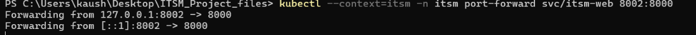</a>
*Screenshot 1.png*

<a href="screenshots/1.1.png">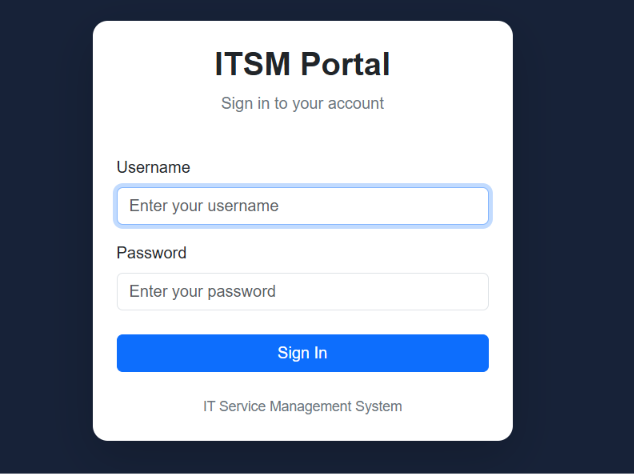</a>
*Screenshot 1.1.png*

<a href="screenshots/2.png">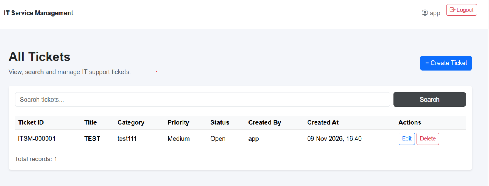</a>
*Screenshot 2.png*

<a href="screenshots/3.png">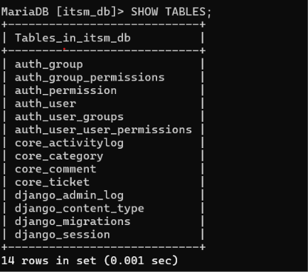</a>
*Screenshot 3.png*

<a href="screenshots/3.1.png">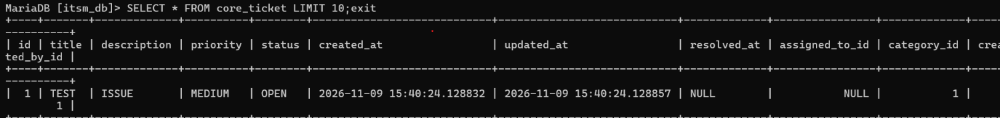</a>
*Screenshot 3.1.png*

<a href="screenshots/4.png">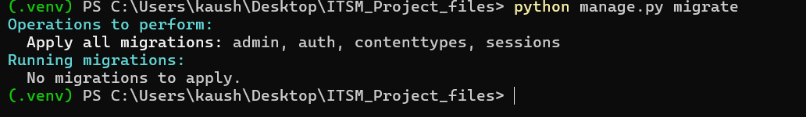</a>
*Screenshot 4.png*

<a href="screenshots/5.png">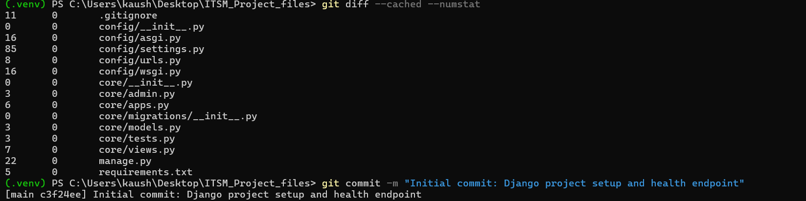</a>
*Screenshot 5.png*

<a href="screenshots/6.png">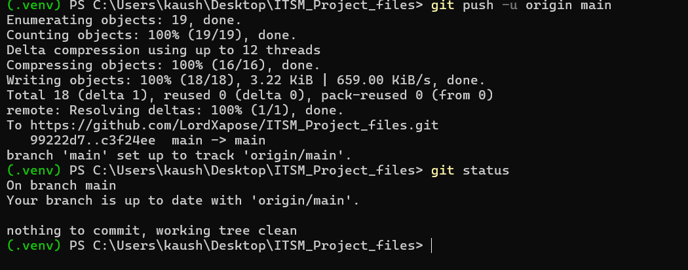</a>
*Screenshot 6.png*

<a href="screenshots/7.png">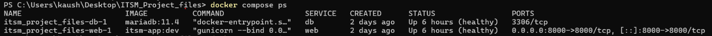</a>
*Screenshot 7.png*

<a href="screenshots/8.png">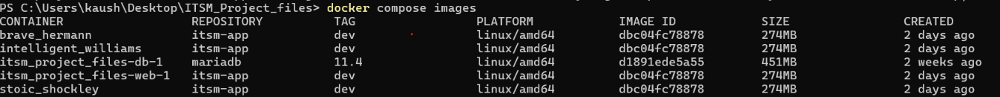</a>
*Screenshot 8.png*

<a href="screenshots/9.png">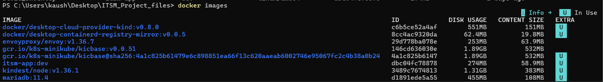</a>
*Screenshot 9.png*

<a href="screenshots/10.png">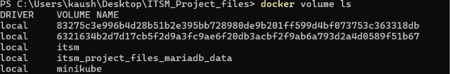</a>
*Screenshot 10.png*

<a href="screenshots/11.png">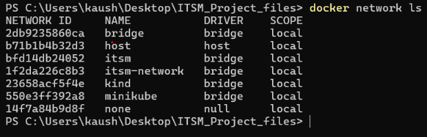</a>
*Screenshot 11.png*

<a href="screenshots/12.png">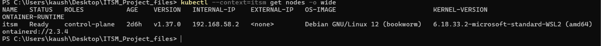</a>
*Screenshot 12.png*

<a href="screenshots/13.png">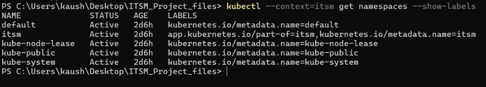</a>
*Screenshot 13.png*

<a href="screenshots/14.png">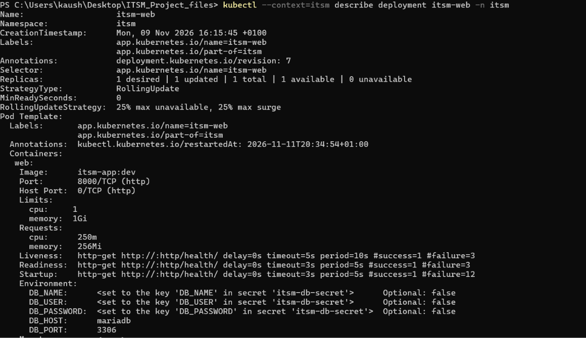</a>
*Screenshot 14.png*

<a href="screenshots/14.1.png">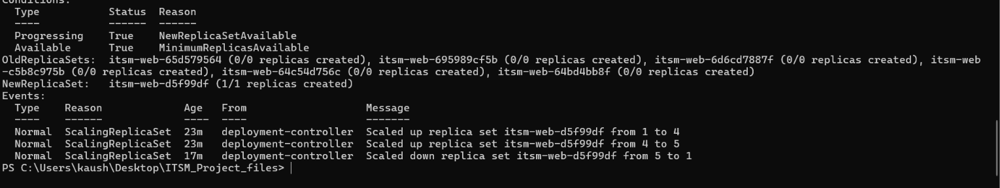</a>
*Screenshot 14.1.png*

<a href="screenshots/15.png">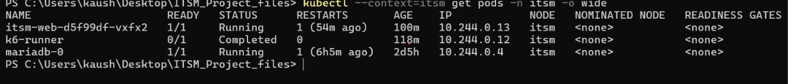</a>
*Screenshot 15.png*

<a href="screenshots/16.png">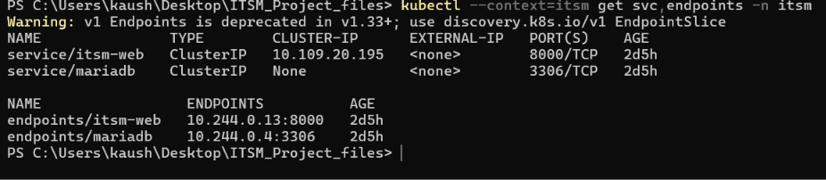</a>
*Screenshot 16.png*

<a href="screenshots/17.png">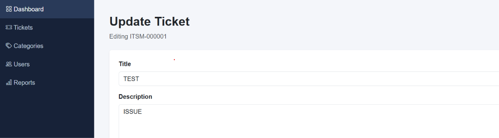</a>
*Screenshot 17.png*

<a href="screenshots/18.png">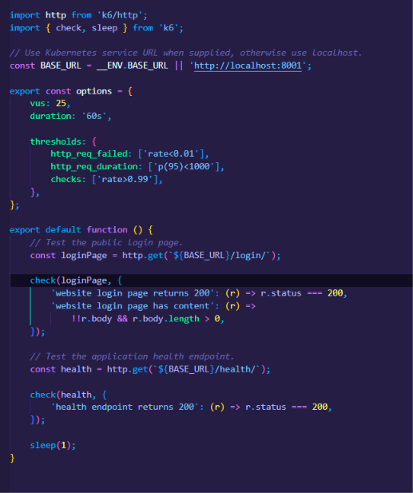</a>
*Screenshot 18.png*

<a href="screenshots/19.png">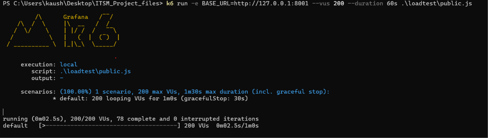</a>
*Screenshot 19.png*

<a href="screenshots/19.1.png">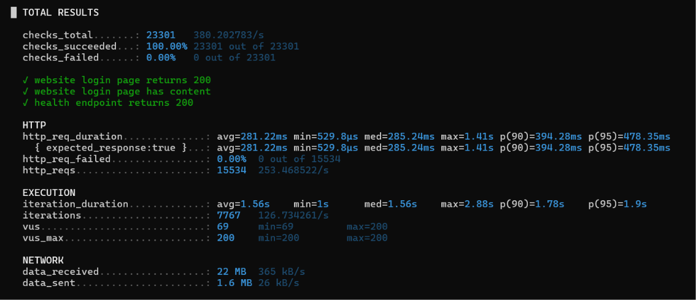</a>
*Screenshot 19.1.png*

<a href="screenshots/21.png">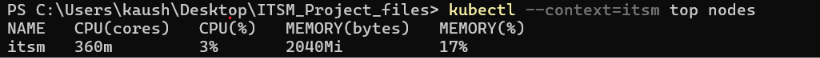</a>
*Screenshot 21.png*

<a href="screenshots/22.png">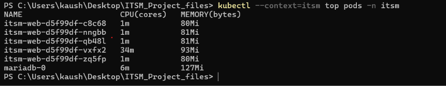</a>
*Screenshot 22.png*

<a href="screenshots/23.png">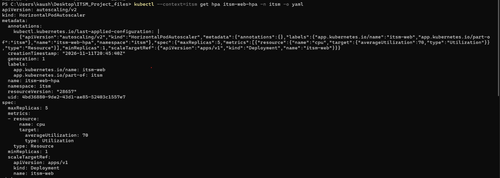</a>
*Screenshot 23.png*

<a href="screenshots/23.1.png">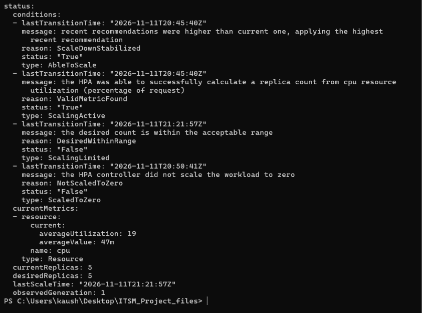</a>
*Screenshot 23.1.png*

<a href="screenshots/24.png">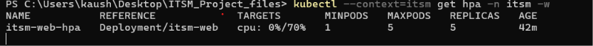</a>
*Screenshot 24.png*

<a href="screenshots/25.png">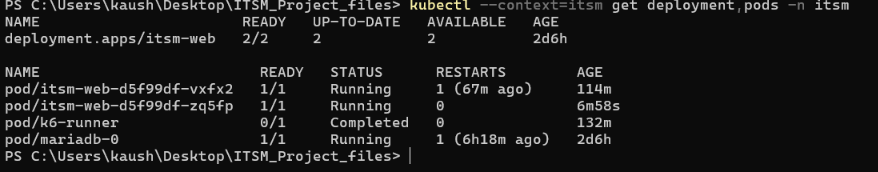</a>
*Screenshot 25.png*

<a href="screenshots/26.png">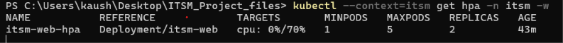</a>
*Screenshot 26.png*

<a href="screenshots/27.png">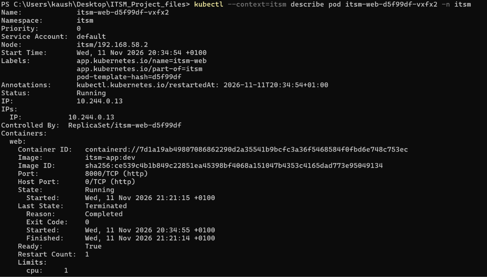</a>
*Screenshot 27.png*

<a href="screenshots/27.1.png">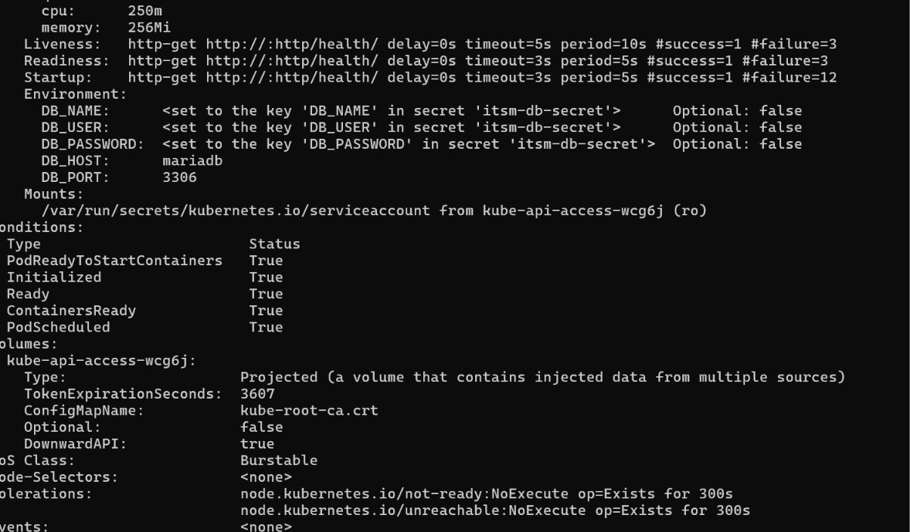</a>
*Screenshot 27.1.png*

<a href="screenshots/28.png">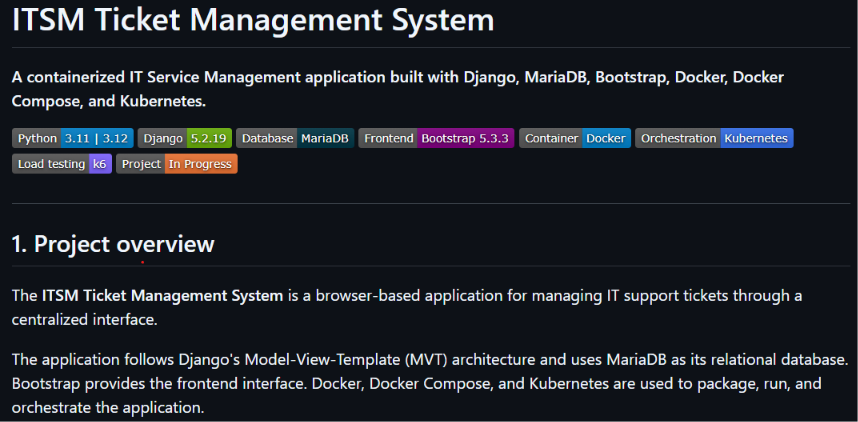</a>
*Screenshot 28.png*

<a href="screenshots/29.png">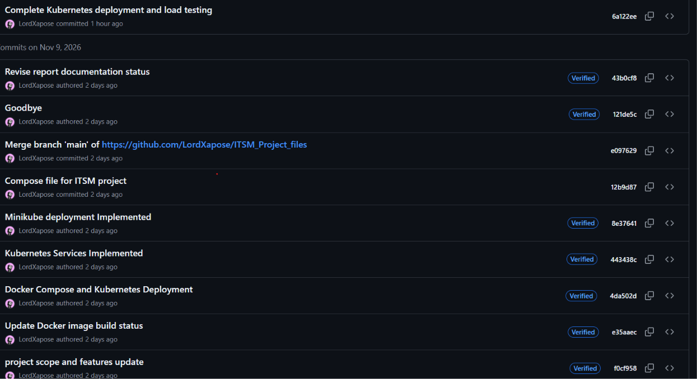</a>
*Screenshot 29.png*

*Screenshot 20 (1).png*

*Screenshot 20 (2).png*

### Ticket workflow and database screenshots

*Screenshot database verify.png*

*Screenshot delete ticketr 2.png*

*Screenshot deleted ticket .png*

*Screenshot ticket 2.png*

*Screenshot ticket delelte.png*

*Screenshot ticket portal.png*

*Screenshot ticket update.png*

### Load-test summary screenshots
<a href="screenshots/500.png">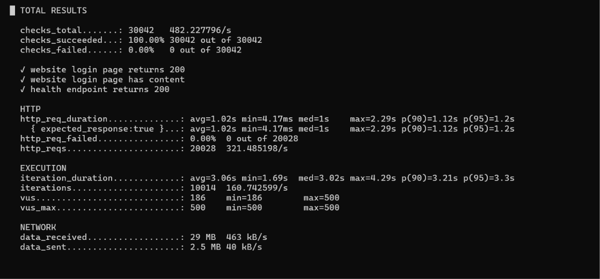</a>
*Screenshot 500.png*

*Screenshot 500 2.png*

<a href="screenshots/stats.png">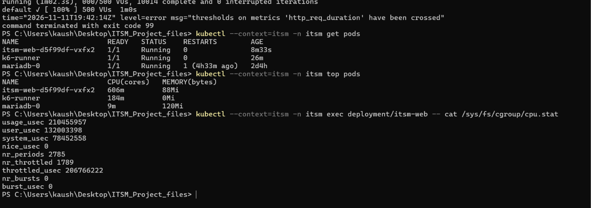</a>
*Screenshot stats.png*

